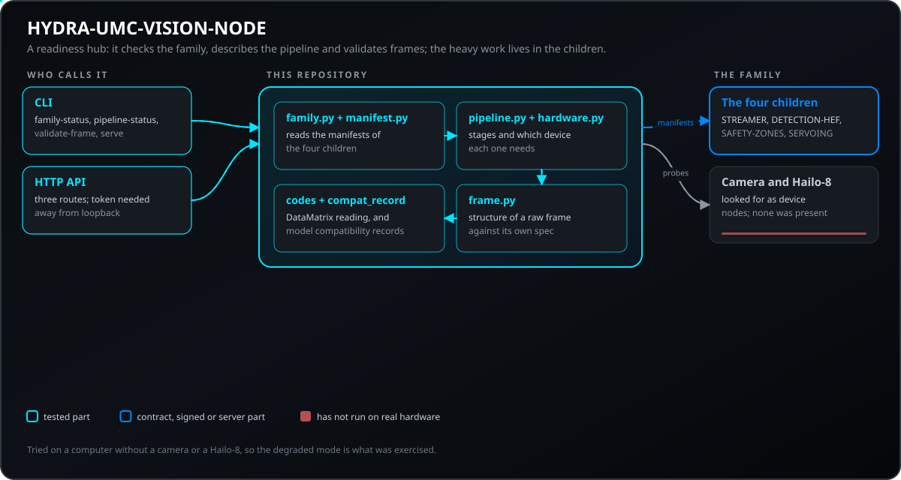
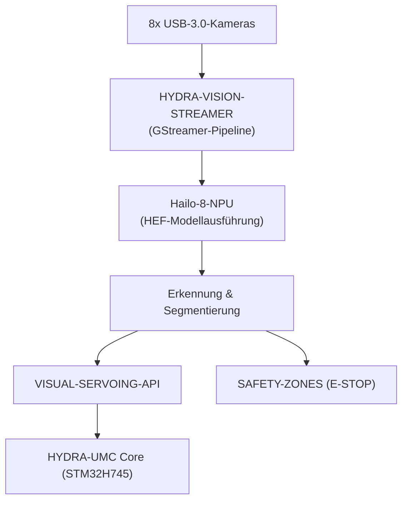
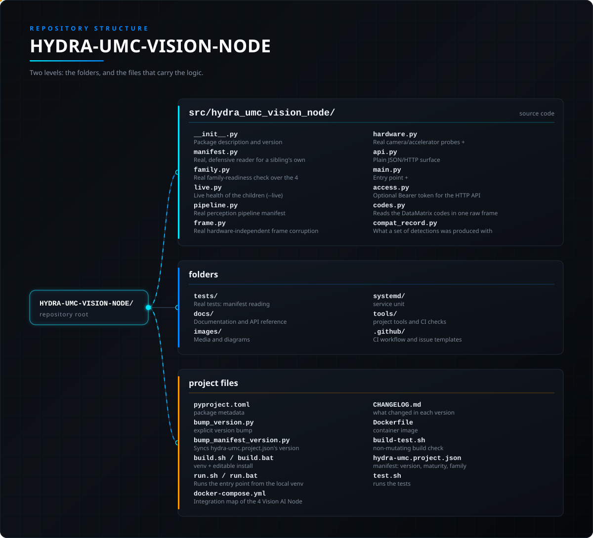

<!-- =============================================================================
HYDRA-UMC-VISION-NODE - Integration parent of the Vision AI Node family
Copyright (C) JuanenRac (Electro Hobby 3D) <electrohobby3d@gmail.com>
GPL-3.0-or-later - see LICENSE
============================================================================= -->

<p align="center">
  
</p>

# 👁️ HYDRA-UMC-VISION-NODE

<p align="center"><a href="README.md">🇺🇸 English</a> | <a href="README_spa.md">🇪🇸 Español</a> | <a href="README_fra.md">🇫🇷 Français</a> | <a href="README_ita.md">🇮🇹 Italiano</a> | 🇩🇪 <b>Deutsch</b> | <a href="README_zho.md">🇨🇳 简体中文</a> | <a href="README_jpn.md">🇯🇵 日本語</a> | <a href="README_por.md">🇵🇹 Português</a></p>

### 🧠 Hochgeschwindigkeits-Edge-KI-Knoten für Wahrnehmung (Hailo-8 + Raspberry Pi CM5)

<p align="center">
  
  
  
  
  
  
  
</p>

---

> **Stand von Sicherheit (Safety) und Security:** Dieses Ökosystem ist kein zertifiziertes Sicherheitssystem. Es gibt noch keinen Hardware-E-STOP-Pfad, keine von der Firmware durchgesetzten Grenzen oder Verriegelungen und keinen verifizierten Bewegungsbefehl; Firmware-Images werden mit CRC-32 und einer Ed25519-Signatur geprüft, und ein Release-Build verweigert die veröffentlichten Entwicklungsschlüssel (die Werkzeugköpfe und Erweiterungsplatinen hinter dem Relais laufen noch mit URTC-Bootloadern, die statt einer Signatur ein HMAC-SHA256 mit gemeinsamem Schlüssel verwenden); TLS und gegenseitiges TLS sind optional und standardmäßig aus; noch keine eigene Platine wurde bestückt oder getestet. Lesen Sie die [Sicherheitsbasis](https://github.com/JuanenRac/HYDRA-UMC-DOCS/blob/main/docs/SECURITY_BASELINE.md) und das [Bedrohungsmodell](https://github.com/JuanenRac/HYDRA-UMC-DOCS/blob/main/docs/THREAT_MODEL.md), bevor Sie sich für die Sicherheit einer Person auf eine Aussage hier verlassen.

---

## 📋 Auf einen Blick

| | |
|---|---|
| Version | `0.1.7` |
| Reifegrad | Funktionsfähig |
| Tests | 262 (`python -m pytest -q tests`) |
| Technik | Python / CM5 / Hailo-8 |
| Ziel | Der Raspberry Pi CM5 einer HYDRA-UMC-Zelle |
| Auf echter Hardware | Noch nicht: für diese Version ist kein Lauf auf echter Hardware vermerkt |

**Springe zu:** [Überblick](#-überblick) · [Architektur](#-architektur) · [Schnellstart](#-schnellstart) · [Tests](#-tests) · [Struktur des Repositorys](#-struktur-des-repositorys) · [Verwandte Projekte](#-verwandte-projekte)

## 🚦 Projektstatus

Jede Zeile ist ein Teil dieses Repositorys, und die Ampel sagt, wie weit er heute ist. Sie beruht auf dem, was das Repository zeigen kann (Tests, Builds, Läufe), nicht auf dem, was geplant ist.

🟢 Fertig und überprüft · 🟡 Funktioniert, mit bekannten Grenzen · 🟠 Teilweise fertig oder noch nicht überprüft · 🔴 Nicht gemacht oder funktioniert nicht

| Bereich | Stand | Was das hier bedeutet |
|---|---|---|
| Software | 🟡 | Funktioniert für seinen Hauptzweck; die Ehrlichkeitsprüfung oben nennt, was noch fehlt |
| Tests | 🟢 | 262 automatische Tests, bei jeder Änderung ausgeführt |
| Echte Hardware | 🔴 | Noch nicht: für diese Version ist kein Lauf auf echter Hardware vermerkt |
| Dokumentation | 🟢 | README in acht Sprachen, bei jeder Änderung gegen das Manifest geprüft |

## 🎯 Überblick

**HYDRA-UMC-VISION-NODE** ist die dedizierte Wahrnehmungs-Engine des HYDRA-UMC-Ökosystems. Ausgelegt für den Raspberry Pi Compute Module 5 in Kombination mit einem Hailo-8-M.2-KI-Beschleuniger, soll er massive Videoströme von bis zu 8 USB-3.0-Kameras gleichzeitig verarbeiten.

Er soll als die „Reflexe“ des Systems dienen: Objektverfolgung, Fehlerinspektion und Sicherheitsüberwachung, ohne den zentralen Orchestrator zu überlasten (geplant: nichts davon läuft bisher auf einem Hailo-8, und es wird keine Präzision behauptet).

Dieses Projekt ist der **Integrations-Elternteil** der Vision-AI-Node-Familie: Es erledigt diese Arbeit nicht selbst, sondern ist der Knoten, an den die 4 spezialisierten Kind-Projekte unten andocken, jedes mit genau einer Verantwortung:

* 🔑 **Optionales Bearer-Token:** auf Loopback braucht die API kein Token; außerhalb von Loopback startet sie ohne eines nicht (`--token-file` oder `HYDRA_UMC_VISION_NODE_TOKEN`). Ist ein Token gesetzt, muss jede Anfrage `Authorization: Bearer <token>` senden (Vergleich in konstanter Zeit); nur `GET /stats`, der Health-Pfad des Manifests, bleibt offen. *(implementiert)*
* **[HYDRA-UMC-VISION-STREAMER](https://github.com/JuanenRac/HYDRA-UMC-VISION-STREAMER)** — erfasst und verarbeitet die Kameraströme vor, die dieser Knoten konsumiert.
* **[HYDRA-UMC-DETECTION-HEF](https://github.com/JuanenRac/HYDRA-UMC-DETECTION-HEF)** — kompiliert und versioniert die `.hef`-Modelle, die dieser Knoten auf seine Hailo-8-NPU lädt.
* **[HYDRA-UMC-SAFETY-ZONES](https://github.com/JuanenRac/HYDRA-UMC-SAFETY-ZONES)** — soll die Wahrnehmung dieses Knotens in Eindringungserkennung und E-STOP-Anforderungen umsetzen (nur v0-Logik; noch kein Detektor speist sie).
* **[HYDRA-UMC-VISUAL-SERVOING-API](https://github.com/JuanenRac/HYDRA-UMC-VISUAL-SERVOING-API)** — soll die Wahrnehmung dieses Knotens in kinematische Posenkorrekturen umsetzen (noch keine Posenschätzung per Kamera).

### Kernpunkte

* 🧩 **Familien-Bereitschaftsprüfung (v0):** der echte `family-status`-Unterbefehl liest die eigene `hydra-umc.project.json` jedes der 4 echten Kinder und meldet Präsenz/Version/Reife/Rolle - ehrlich für einen Integrations-Elternteil, der noch keine eigene Hailo-8-Laufzeit oder Kamera-Pipeline betreibt.
* 🩺 **Pipeline-Manifest, Frame-Validierung & Degradierter Modus (v0):** ein echtes, einsehbares Manifest der Form der Wahrnehmungspipeline dieses Knotens (welche Stufen eine Kamera, einen Beschleuniger oder keins von beidem benötigen), echte strukturelle Beschädigungsprüfung eines rohen Frame-Puffers, und echte Erkennung des degradierten Modus, die ehrlich nach echter Kamera-/Hailo-8-Hardware sucht und genau meldet, welche Stufen gerade laufen können - über die neuen Unterbefehle `pipeline-status` und `validate-frame`.
* 🌐 **JSON/HTTP-API (v0):** der echte Unterbefehl `serve` stellt `family-status`/`pipeline-status`/`validate-frame` als HTTP-API bereit (`GET /family-status`, `GET /pipeline-status`, `POST /validate-frame`, plus `GET /stats`) - genau dieselben Funktionen, die auch die CLI-Unterbefehle ausführen, auf Basis von `http.server`, ohne zusätzliche Abhängigkeit. Siehe „Die JSON/HTTP-API" weiter unten und [`docs/CLI_REFERENCE.md`](docs/CLI_REFERENCE.md).
* 🏷️ **Lesen des Platinencodes:** `POST /read-code?width=W&height=H&channels=N` nimmt ein rohes Bild als Body (dieselbe Form wie `/validate-frame`) und liefert die darin enthaltenen DataMatrix-Codes, für die Pick-and-Place-Bridge, die den Code einer Platine mit der Platine ihres Auftrags vergleicht. Der Decoder ist `pylibdmtx`, eine optionale Abhängigkeit, die beim ersten Gebrauch importiert wird: ohne sie antwortet die Route mit `503` und sagt, was zu installieren ist, die übrigen Routen bleiben unberührt. Der Text eines Codes ist begrenzt (druckbares ASCII, höchstens 256 Zeichen, höchstens 16 Codes). Mit einem simulierten Decoder getestet; nicht an einem echten Etikett erprobt. *(implementiert)*
* 🚀 **Hardwarebeschleunigung (geplant):** Ziel ist die native Ausführung von HEF-Modellen auf Hailo-8 (26 TOPS) - die Toolchain, die diese Modelle kompiliert, ist ein separates Projekt ([HYDRA-UMC-DETECTION-HEF](https://github.com/JuanenRac/HYDRA-UMC-DETECTION-HEF)), nicht etwas, das dieser Knoten selbst baut.
* 📷 **Multi-Stream-Verarbeitung (geplant):** gleichzeitige Analyse von bis zu 8 hochauflösenden Kameraströmen, vorgelagert erfasst von [HYDRA-UMC-VISION-STREAMER](https://github.com/JuanenRac/HYDRA-UMC-VISION-STREAMER).
* 🎯 **Präzisionswahrnehmung (geplant):** ausgelegt auf Architekturen der YOLO-Familie für die Erkennung industrieller Komponenten.
* 🛡️ **Aktive Sicherheit (geplant):** Echtzeit-Belegungskartierung, die [HYDRA-UMC-SAFETY-ZONES](https://github.com/JuanenRac/HYDRA-UMC-SAFETY-ZONES) für die Erkennung menschlichen Eindringens speist.
* 🧩 **Warum es existiert:** Ohne einen dedizierten Knoten würde die Wahrnehmungsarbeit den Echtzeitkern STM32H745 in [HYDRA-UMC](https://github.com/JuanenRac/HYDRA-UMC) überlasten (der dafür keine freien Zyklen hat) oder jeden Kameraframe zu einer entfernten GPU zwingen, was eine Latenz hinzufügt, die sich die Sicherheitsschleife nicht leisten kann. Der Betrieb auf CM5 + Hailo-8, physisch neben dem Roboter, hält die Schleife Erkennen → Korrigieren → (falls nötig) E-STOP lokal und schnell.
* 🖼️ **Pixelformat und Zeilenabstand in Frame-Spezifikationen:** Eine Spezifikation kann ein Pixelformat (`GRAY`, `RGB`, `BGR`, `RGBA`, `BGRA`, `YUYV`, `NV12`) und einen Zeilenabstand nennen; die erwartete Größe folgt ihnen, und eine unmögliche Kombination wird als `invalid_spec` gemeldet. Ein Wächter für eingefrorene Bilder markiert einen Sensor, der Byte für Byte dasselbe Bild liefert (`frozen_frame`).
* 🩺 **`family-status --live` (standardmäßig aus):** Neben dem Lesen der Manifeste fragt es jedes Kind, das einen Dienst deklariert, einmal mit kurzer Zeitgrenze an, auf Loopback, sofern `--host` nichts anderes sagt, und gibt Latenz und gemeldete Version aus; es schlägt fehl, wenn eines nicht antwortet.
* 🎞️ **`serve --vision-sim DATEI` (standardmäßig aus, nur Simulation):** simulierte Bildquellen (ein deterministischer synthetischer Generator und ein Ordner mit Raw- oder PGM/PPM-Bildern), eine Modellregistrierung mit deklariertem Format, Eingabegröße, Genauigkeit und Gerät (`cpu` oder `hailo`) und eine deterministische Wahl des besten Modells für die Geräte, die der Host in der Datei angibt (es wird nichts erkannt), mit Begründung der Wahl und jedes Ausschlusses, dazu eine Schleife mit einem Attrappenmodell, die die Latenz-Perzentile speist. Fügt `GET /models`, `GET /sources`, `POST /models/select` und `POST /inference/simulate` hinzu; ohne den Schalter antworten sie mit 404. Es gibt weder echte Inferenz noch eine echte Kamera: eine Kamera- oder RTSP-Quelle braucht weiterhin Hardware. Ein Lauf ist zeitlich begrenzt (`limits.maxRunSeconds` der Datei, standardmäßig 10 s; null oder negativ weist die Datei ab): danach kommt das Teilergebnis mit `truncated: true` und dem Grund zurück, und es läuft nur eine Simulation gleichzeitig (`409` für eine zweite), während die übrigen Routen weiter antworten.

**Ehrlichkeitscheck - was heute wirklich läuft:** Der bloße Aufruf gibt weiterhin Identität/Version/Rolle aus, aber es gibt jetzt drei echte Unterbefehle: `family-status [--workspace PFAD]` (liest die echten, eigenen Manifeste der 4 echten Kinder), `pipeline-status` (sondiert echte Hardware und meldet den echten, ehrlichen Modus - `full`, oder einen ehrlichen degradierten Modus auf einer Maschine ohne Kamera/Hailo-8, wie dieser Entwicklungsmaschine) und `validate-frame <pfad> --width --height` (echte strukturelle Beschädigungsprüfung eines Frame-Puffers). Nichts von der Hailo-8-Laufzeit, der gRPC-Steuerungs-API oder der echten Kind-Überwachung existiert bereits - sie sind der Daseinsgrund dieses Projekts, nicht etwas, das es heute tut. Siehe [`CHANGELOG.md`](CHANGELOG.md) für genau das, was bisher geliefert wurde, und den Abschnitt "Aktueller Status & Nächste Schritte" unten für das, was noch offen ist.

**Grenzen der API:** `POST /validate-frame` weist Frames über 8192x8192x4 oder 64 MiB (und nicht positive Größen) ab, bevor der Body gelesen wird, und `?workspace=` darf nur innerhalb des Workspace zeigen, mit dem der Server gestartet wurde. In einem Container stammt der Workspace aus `HYDRA_UMC_WORKSPACE` (die Schwester-Checkouts schreibgeschützt unter `/workspace` einhängen, wie es `docker-compose.yml` tut). Die systemd-Unit behält das echte `/dev`, damit die Kamera- und Beschleuniger-Prüfungen funktionieren, und begrenzt Geräte mit `DevicePolicy=closed` statt `PrivateDevices`.

## 🧩 Rolle in HYDRA-UMC

**HYDRA-UMC-VISION-NODE** ist der Integrationsknoten der Vision-AI-Node-Familie. Er betreibt weder Kamera noch Beschleuniger oder Erkennung selbst: Er prüft, ob seine vier Kinder vorhanden und bereit sind, beschreibt die Wahrnehmungskette Stufe für Stufe, validiert rohe Kamerabilder und liest DataMatrix-Codes.

## 🏛️ Architektur

<p align="center">
  
</p>

<details>
<summary>Textversion des Diagramms (Mermaid)</summary>



</details>

### GEPLANTER SYSTEMFLUSS

Das Diagramm unten ist der Ziel-Datenfluss, auf den dieses Skelett hinarbeitet - es dokumentiert die Architekturentscheidung, keine heute lauffähige Pipeline.

### ERWEITERTE TECHNISCHE INFORMATIONEN

### Warum dieses Projekt der Integrations-Elternteil ist (und was das konkret bedeutet)

Von den 5 Projekten der Vision-AI-Node-Familie ist dieses das einzige, das:

* Einen Ordner **`os/`** trägt — die Konfiguration des gemeinsamen HydraOS-Systemabbilds für den CM5-Host. Die 4 Kinder laufen als Prozesse/Container *auf* diesem einen gemeinsamen Systemabbild; es gibt keinen Grund, warum jedes eine eigene Kopie tragen sollte.
* Einen Ordner **`models/`** trägt — die kompilierten `.hef`-Modelle, die zur Laufzeit tatsächlich auf die Hailo-8-NPU geladen werden. [HYDRA-UMC-DETECTION-HEF](https://github.com/JuanenRac/HYDRA-UMC-DETECTION-HEF) ist der Ort, an dem diese Modelle *kompiliert und versioniert* werden; dieser Knoten ist der Ort, an dem die *ausgelieferte, laufende Kopie* lebt, weil er der Prozess ist, dem das Hailo-8-Gerätehandle gehört.
* **`docker-compose.yml`** trägt — siehe unten.

Keines der 5 Projekte trägt einen `hardware/`- oder `firmware/`-Ordner: CM5 + Hailo-8 ist handelsübliche Hardware ohne eigenes zu entwerfendes Board, anders als (zum Beispiel) die kundenspezifischen STM32H745/STM32G474-Boards in [HYDRA-UMC](https://github.com/JuanenRac/HYDRA-UMC).

### `docker-compose.yml`: die Integrationskarte, gebaut aus den Dockerfiles der Kinder (hier nie mit Docker ausgeführt)

`docker-compose.yml` im Projektstamm definiert den eigenen Dienst dieses Knotens sowie die 4 Kinder, verdrahtet mit den Devices/Volumes/Ports, die jedes voraussichtlich benötigt (das Hailo-8-Gerät, die V4L2-Geräte pro Kamera, die gRPC-Ports zum HYDRA-UMC-Core). Sie ist ausführlich kommentiert, um zu erklären, *warum* jedes Teil dort ist. Alle 4 Kinder liefern inzwischen ein eigenes `Dockerfile`, und der Stack wird daraus gebaut, aber er wurde **nie in einer Umgebung mit Docker gebaut oder ausgeführt** (in der Entwicklungsumgebung gibt es keines): seine Form und seine Befehle wurden von Hand gegen diese Dockerfiles und die echten systemd-Units des CM5 geprüft. Sie existiert, damit die Form der Integration einmal entschieden und dokumentiert wird, statt von jedem Kind separat improvisiert zu werden.

### In diesem Skelett bereits getroffene Designentscheidungen

* **Die Version wird aus den Metadaten des installierten Pakets gelesen, nicht fest codiert.** `main.py` ruft `importlib.metadata.version("hydra-umc-vision-node")` auf, statt eine zweite `__version__`-Zeichenkette irgendwo im Paket zu pflegen. Das bedeutet, `bump_version.py` hat nur eine Stelle zu bearbeiten (`pyproject.toml`), und die ausgegebene Version kann nie stillschweigend davon abweichen.
`MAJOR` ist eine bewusste menschliche, semantische Entscheidung (ein echter Architektur-Meilenstein), keine Sache, die ein Build-Skript allein entscheiden sollte. Dies ist dieselbe Konvention, die bereits im übrigen Ökosystem verwendet wird (siehe `HYDRA-UMC-EDITOR-URDF/bump_version.py` und `HYDRA-UMC-SUITE/bump_version.py`).
* **gRPC/Protobuf statt REST für die geplante Steuerungs-API** (siehe Badge oben) - gewählt, weil die Schleife Wahrnehmung → Korrektur → Firmware, in der dieser Knoten lebt, latenzempfindlich ist und mit anderen Python-/Embedded-Diensten im selben LAN spricht, wo das binäre Framing und die Streaming-Unterstützung von gRPC besser passen als JSON über HTTP. Noch nicht implementiert; hier dokumentiert, damit die Richtung klar ist, bevor der Code kommt.
* **`family-status` liest das eigene Manifest jedes Kindes statt einer manuell gepflegten Liste.** `hydra-umc.project.json` ist bereits die einzige Quelle der Wahrheit, der das Dashboard/der Updater des Ökosystems vertrauen - eine zweite Liste hier würde in dem Moment abdriften, in dem sich die echte Reife eines Kindes ändert und niemand daran denkt, sie zu aktualisieren.
* **Ein fehlender Geschwister-Checkout ist ein echtes, ehrliches „nicht gefunden", kein Absturz.** Ein Integrations-Parent kann wirklich nicht wissen, ob ein Entwickler alle 4 Kinder lokal ausgecheckt hat - `manifest.py` gibt für jeden echten Fehlerfall (fehlendes Repo, fehlende Datei, fehlerhaftes JSON) `None` zurück, sodass `family-status` es klar melden kann, statt eine Exception auszulösen.
* **Warum die Erkennung des degradierten Modus in eine Prüfung und eine reine Entscheidungsfunktion aufgeteilt ist.** `hardware.py`s `camera_available()`/`accelerator_available()` sind die einzigen Teile, die jemals echte Hardware berühren (einen Linux-Gerätenode); `determine_mode()`/`active_stages()` nehmen einfache Booleans entgegen und enthalten die eigentliche Entscheidungslogik. Diese Trennung ist es, die es erlaubt, jede echte Hardwarekombination (vollständig, keine Kamera, kein Beschleuniger, gar keine Hardware) direkt und deterministisch zu testen, ohne ein Dateisystem zu mocken oder echte CM5+Hailo-8-Hardware zu benötigen, um die Logik als korrekt zu beweisen.
* **Warum die Frame-Validierung nur die Struktur prüft, nicht den Pixelinhalt.** Das Erkennen eines abgeschnittenen/übergroßen Puffers oder eines verdächtig gleichförmigen (ein eingefrorener Sensor, eine leere Aufnahme) ist eine echte, nützliche, hardwareunabhängige Validierung, die kein Referenzbild und keine Kamera braucht, um ehrlich getestet zu werden. Zu entscheiden, ob der tatsächliche INHALT eines Frames falsch aussieht (Unschärfe, Belichtung, eine echte Bildqualitätsmetrik), ist ein grundlegend anderes, viel schwierigeres Problem, das echte aufgenommene Frames zum Kalibrieren bräuchte - für dieses v0 ausdrücklich außerhalb des Umfangs.

## 🚀 Schnellstart

Benötigt Python 3.10 oder neuer.

```bash
./build.sh  # Linux, macOS (build.bat on Windows)
./run.sh family-status
./run.sh pipeline-status
./run.sh validate-frame frame.raw --width 640 --height 480
./run.sh serve --port 8105
```

## 🧪 Tests

262 automatische Tests laufen mit `python -m pytest -q tests`. Sie brauchen weder Hardware noch etwas außerhalb dieses Rechners.

Die CI führt `HYDRA_UMC_CI=1 python tools/ci_validate.py` aus; das prüft das Manifest, die Dokumente, die acht READMEs und die Bilder.

## 🏗️ Build und Veröffentlichung

### Voraussetzungen

* **Python 3.10 oder neuer** im `PATH` (geprüft via `python3`/`python` - beide Skripte probieren beides).
* Kein System-Hailo-SDK, GStreamer oder andere native Abhängigkeit wird bisher benötigt - das Skelett hat **null Drittanbieter-Laufzeitabhängigkeiten** (`dependencies = []` in `pyproject.toml`). Diese kommen hinzu, sobald die entsprechende reale Logik eintrifft.
* Genug Festplattenplatz für eine lokale virtuelle Umgebung (angelegt unter `.venv/`, in dieser Phase einige Dutzend MB).

### Schritt für Schritt - was jeder Befehl wirklich tut

```bash
# Linux / macOS
./build.sh
```

1. **Versionsprüfung** - liest und zeigt die Projektversion an; Bauen ändert sie nie (nur `python tools/hydra_project_tool.py bump` erhöht sie).
2. **Virtuelle Umgebung** — erstellt `.venv/`, falls noch nicht vorhanden (sicher erneut auszuführen; ein vorhandenes `.venv/` wird wiederverwendet, nicht neu erstellt).
3. **Editierbare Installation** — `pip install -e .` installiert dieses Paket im "editierbaren" Modus in `.venv`, sodass Quelländerungen unter `src/` sofort wirksam werden, ohne Neuinstallation, und registriert den von `run.sh` genutzten Konsolen-Einstiegspunkt `hydra-umc-vision-node`.
4. **Compile-Check** — `python -m compileall -q src` kompiliert jede `.py`-Datei unter `src/` zu Bytecode und findet so Syntaxfehler im gesamten Paket, auch in Dateien, die `main.py` nie tatsächlich importiert.
5. **Echte Test-Suite** — `pytest tests/` führt alle 262 Tests aus.

Das Skript verwendet `set -euo pipefail` und stoppt beim ersten fehlschlagenden Schritt; `Build complete.` (`build.sh`) / `== Build OK ==` (`build.bat`) wird nur ausgegeben, wenn alle 5 Schritte erfolgreich waren.

```bash
./run.sh
```

Sucht den Python-Interpreter innerhalb von `.venv` (unterstützt sowohl das POSIX-Layout `.venv/bin/python` als auch das Windows-Layout `.venv/Scripts/python.exe`, da dieses Repo plattformübergreifend entwickelt wird) und führt `python -m hydra_umc_vision_node.main` aus, das den Namen, die Version und die Rolle ausgibt und alle Argumente weiterreicht.

Der bloße Aufruf gibt Name + Version + Rolle aus:

```text
HYDRA-UMC-VISION-NODE v0.1.7
High-speed perception edge AI node (Hailo-8 + CM5) - integration parent of Vision-Streamer, Detection-HEF, Safety-Zones and Visual-Servoing-API.
```

Der echte Unterbefehl `family-status` prüft den tatsächlichen lokalen Checkout:

```bash
./run.sh family-status
./run.sh family-status --workspace /path/to/some/other/checkout

# Windows
run.bat family-status
```

Verwendet standardmäßig das übergeordnete Verzeichnis dieses Repos - das echte Layout mit Geschwister-Checkouts, das dieses Ökosystem bereits nutzt. Beendet sich mit `1`, falls ein echtes Kind fehlt.

Der echte Unterbefehl `pipeline-status` sondiert die tatsächliche Hardware und meldet das echte, ehrliche Ergebnis:

```bash
./run.sh pipeline-status
```
```json
{
  "manifest": { "version": "0.1.0", "stages": [ "..." ] },
  "cameraPresent": false,
  "acceleratorPresent": false,
  "mode": "degraded_no_hardware",
  "runnableStages": ["preprocess", "postprocess", "publish"],
  "skippedStages": ["capture", "inference"]
}
```

Auf dieser Entwicklungsmaschine (kein CM5, kein Hailo-8, keine Kamera) ist das die echte, ehrliche Antwort - Exit-Code `1` (alles außer dem Modus `full`). Der echte Unterbefehl `validate-frame` prüft eine rohe Frame-Puffer-Datei auf strukturelle Beschädigung:

```bash
./run.sh validate-frame path/to/frame.raw --width 1920 --height 1080
# Frame OK: path/to/frame.raw matches 1920x1080x3 (6220800 bytes)

./run.sh validate-frame path/to/truncated.raw --width 1920 --height 1080
# Frame INVALID: path/to/truncated.raw
#   [size_mismatch] frame buffer is ... bytes, expected 6220800 bytes ... - likely truncated or corrupt
```

```bat
:: Windows - gleiche Schritte, Batch-Syntax
build.bat
run.bat
```

### Die JSON/HTTP-API

Der echte Unterbefehl `serve` führt `family-status`/`pipeline-status`/`validate-frame` als reine JSON/HTTP-API aus statt als einmaligen CLI-Aufruf - dieselbe Konvention, die die anderen `api.py`-Dateien dieser Familie bereits verwenden, aufgebaut auf `http.server` der Standardbibliothek (`ThreadingHTTPServer`), ohne zusätzliche Laufzeitabhängigkeit:

```bash
./run.sh serve --addr 127.0.0.1 --port 8094
```

| Route | Methode | Hinweise |
|---|---|---|
| `/family-status` | `GET` | Wie der Unterbefehl `family-status`. Der optionale Query-Parameter `?workspace=PFAD` überschreibt den Standard-Workspace des Servers nur für diese eine Anfrage. |
| `/pipeline-status` | `GET` | Wie der Unterbefehl `pipeline-status`. |
| `/read-code` | `POST` | Die DataMatrix-Codes eines als Body gesendeten rohen Bildes, mit `?width=W&height=H` und optionalem `channels` (Standard 3) wie bei `/validate-frame`; antwortet `{"codes": [...], "count": N}` oder `503`, wenn `pylibdmtx` nicht installiert ist. |
| `/validate-frame` | `POST` | Dieselbe Prüfung wie der Unterbefehl `validate-frame`, aber die rohen Frame-Bytes reisen im Anfrage-Body statt als serverseitiger Dateipfad - ein echter entfernter Aufrufer hat keinen lokalen Pfad auf dem eigenen Dateisystem dieses Servers, den er übergeben könnte. Erfordert die Query-Parameter `?width=W&height=H` (`channels` optional, Standard `3`). |
| `/stats` | `GET` | Meldet den Standard-Workspace-Pfad des Servers. |

Beispiel für `/validate-frame`, mit demselben 48-Byte-Fixture wie im CLI-Durchlauf oben:

```bash
curl -X POST "http://127.0.0.1:8094/validate-frame?width=4&height=4&channels=3" --data-binary @vn_good_frame.raw
# {"valid": true, "expectedBytes": 48, "actualBytes": 48, "issues": []}
```

Jede Route antwortet mit einem ehrlichen Fehler-Body (`{"error": "..."}`) und dem passenden HTTP-Status - `400` für fehlerhafte/fehlende Query-Parameter, `404` für eine unbekannte Route - statt still zu scheitern. Vollständige Referenz route für route: [`docs/CLI_REFERENCE.md`](docs/CLI_REFERENCE.md).

### Fehlerbehebung

* **`python`/`python3` nicht gefunden** — Python 3.10+ installieren und sicherstellen, dass es im `PATH` liegt; `build.sh` verwendet `python3`, `build.bat` verwendet `python`.
* **`compileall` schlägt fehl** — bedeutet, dass ein echter Syntaxfehler unter `src/` eingeführt wurde; das Build-Skript beendet sich absichtlich mit Fehlercode, ohne die Installation zu erstellen/aktualisieren, damit ein kaputtes Paket nie als "erfolgreicher Build" dargestellt wird.
* **`run.sh`/`run.bat` meldet "No `.venv` found"** — `build.sh`/`build.bat` muss vorher mindestens einmal ausgeführt worden sein; `run.sh`/`run.bat` erstellt die Umgebung nie selbst, nur Builds tun das.
* **Veraltete editierbare Installation nach einem Pull** — `.venv/` löschen und `build.sh`/`build.bat` erneut ausführen; selten nötig, da `pip install -e .` Codeänderungen normalerweise ohne Neuinstallation erfasst.

## 📂 Struktur des Repositorys

<p align="center">
  
</p>

<details>
<summary>Textversion des Baums</summary>

```text
HYDRA-UMC-VISION-NODE/
├── src/hydra_umc_vision_node/   Quellcode
│   ├── __init__.py              Paketbeschreibung und Version
│   ├── manifest.py              Echter, defensiver Reader für das Manifest eines Geschwisterprojekts
│   ├── family.py                Echte Familien-Bereitschaftsprüfung über die 4 echten Kinder
│   ├── live.py                  Live-Zustand der Kinder (--live)
│   ├── pipeline.py              Echtes Wahrnehmungs-Pipeline-Manifest (Stufen + Hardware-Bedarf)
│   ├── frame.py                 Echte, hardwareunabhängige Frame-Beschädigungsprüfung
│   ├── hardware.py              Echte Kamera-/Beschleuniger-Sonden + Logik für degradierten Modus
│   ├── api.py                   Einfache JSON/HTTP-Oberfläche (stdlib http.server) über die 3 echten Subbefehle
│   ├── main.py                  Einstiegspunkt + `family-status`/`pipeline-status`/`validate-frame`
│   ├── access.py                Optionales Bearer-Token für die HTTP-API (auf Loopback nicht nötig, sonst Pflicht)
│   ├── codes.py                 Liest die DataMatrix-Codes in einem Rohbild (die Identität einer Platine in einer Bestückungszelle)
│   └── compat_record.py         Womit ein Satz Erkennungen erzeugt wurde (Modell, Version, SHA-256, Architektur) und ob er noch passt
├── tests/                       Echte Tests: Manifest-Lesen, Familienstatus, Pipeline, Frame, Hardware, api, CLI
├── docs/                        Dokumentation und API-Referenz
├── images/                      Medien und Diagramme
├── systemd/                     Dienst-Unit
├── tools/                       Projektwerkzeuge und CI-Prüfungen
├── .github/                     CI-Workflow und Issue-Vorlagen
├── pyproject.toml               Paketmetadaten
├── bump_version.py              ausdrückliche Versionserhöhung
├── bump_manifest_version.py     Synchronisiert die Version von hydra-umc.project.json mit der nativen (--sync)
├── build.sh / build.bat         venv + editierbare Installation + Compile-Check
├── run.sh / run.bat             Führt den Einstiegspunkt aus dem lokalen venv aus
├── docker-compose.yml           Integrationskarte der 4 Kinder (nicht mit Docker geprüft)
├── CHANGELOG.md                 was sich in jeder Version geändert hat
├── Dockerfile                   Container-Image
├── build-test.sh                Build-Prüfung ohne Änderungen
├── hydra-umc.project.json       Manifest: Version, Reifegrad, Familie
└── test.sh                      führt die Tests aus
```

</details>

## 🗺️ Roadmap und bekannte Grenzen

**Bekannte Grenzen heute**

**Was heute funktioniert:** eine echte Familien-Bereitschaftsprüfung (`manifest.py`/`family.py`), ein echtes Pipeline-Manifest und eine echte Erkennung des degradierten Modus (`pipeline.py`/`hardware.py`), die ehrlich nach echter Kamera-/Hailo-8-Hardware sucht, eine echte, hardwareunabhängige Frame-Beschädigungsprüfung (`frame.py`), die CLI-Unterbefehle `family-status`/`pipeline-status`/`validate-frame` plus einen Unterbefehl `serve`, der alle drei als JSON/HTTP-API bereitstellt (`api.py`), 262 bestandene echte Tests (siehe [`CHANGELOG.md`](CHANGELOG.md) für die genau erfasste Build-/Run-Ausgabe).

**Was noch offen ist, ohne bestimmte Reihenfolge und ohne verbindlichen Zeitplan:**

* Die tatsächliche Hailo-8-Laufzeitinitialisierung und die Inferenzschleife.
* Die gRPC-Steuerungs-API zum HYDRA-UMC-Core.
* Echte Überwachung der 4 Kind-Dienste (heute dokumentiert `docker-compose.yml` nur die geplante Form).
* Multi-Kamera-Pipeline-Synchronisation, sobald [HYDRA-UMC-VISION-STREAMER](https://github.com/JuanenRac/HYDRA-UMC-VISION-STREAMER) eine echte Erfassungspipeline hat, mit der synchronisiert werden kann.
* `docker-compose.yml` in einer Umgebung mit Docker wirklich bauen und ausführen (die 4 Kinder liefern ihr `Dockerfile` bereits).

## 🌍 Sprachen

Diese README und die Dokumente des Repositorys gibt es in acht Sprachen: Englisch, Spanisch, Deutsch, Französisch, Italienisch, Japanisch, Chinesisch und Portugiesisch (Portugal). Sie entstehen gemeinsam, und die CI prüft, dass die acht Dateien dieselben Abschnitte und dieselben Links haben. Dieses Repository hat weder eine eigene Oberfläche noch einen eigenen Meldungskatalog, es gibt also keine Oberflächentexte zu übersetzen.

## 🔗 Verwandte Projekte

Dieses Projekt ist Teil des HYDRA-UMC-Robotik-Ökosystems desselben Autors (JuanenRac / Electro Hobby 3D). Gut zu wissen, da eine Anfrage eigentlich eines dieser Projekte betreffen könnte statt dieses Repositorys.

**Untergeordnete Projekte** — jedes davon ist eine bestimmte Stufe oder ein Verbraucher der eigenen Hailo-8-Wahrnehmungspipeline dieses Knotens
- **[HYDRA-UMC-DETECTION-HEF](https://github.com/JuanenRac/HYDRA-UMC-DETECTION-HEF)** — echte Registry für kompilierte Modelle mit Hailo-Architektur-/Prüfsummen-Safe-Load-Verifizierung.
- **[HYDRA-UMC-VISION-STREAMER](https://github.com/JuanenRac/HYDRA-UMC-VISION-STREAMER)** — echter GStreamer-Pipeline- + MediaMTX-Konfigurationsgenerator mit einer echten HailoRT-Integrationsschranke.
- **[HYDRA-UMC-SAFETY-ZONES](https://github.com/JuanenRac/HYDRA-UMC-SAFETY-ZONES)** — v0-Logik für Zonenverletzung, Kalibrierungsaktualität und E-STOP-Anforderung, die Objektpositionen aus einer Datei nimmt; kein Detektor speist sie, und noch kein physischer E-STOP ist angeschlossen.
- **[HYDRA-UMC-VISUAL-SERVOING-API](https://github.com/JuanenRac/HYDRA-UMC-VISUAL-SERVOING-API)** — Position-Based-Visual-Servoing-Korrekturgesetz mit Freigabe abhängig vom Zonenstatus; noch keine Posenschätzung per Kamera.

**Direkt verwandt**
- **[HYDRA-UMC](https://github.com/JuanenRac/HYDRA-UMC)** — der Entwurf des Motherboards des Roboterarms: CM5-Host + Dual-Core-STM32H745, gedacht zur Koordination von bis zu 8 Werkzeugarmen über CAN-OTA/SPI-OTA (Firmware in einer frühen Phase; noch keine bestückte Platine); eine Wahrnehmungs-/E-STOP-Schleife zwischen diesem Knoten und dieser Firmware gibt es noch nicht.
- **[HYDRA-UMC-COGNITIVE-NODE](https://github.com/JuanenRac/HYDRA-UMC-COGNITIVE-NODE)** — Integrationsknoten für die Hailo-10-Cognitive-Pipeline (LLM-/VLA-/Sprach-Orchestrierung), aufgebaut als semantische Schicht direkt über der eigenen Wahrnehmungsausgabe dieses Knotens.

**Ebenfalls Teil des Ökosystems**

*Kern-Hardware & Plattform*
- **[HYDRA-UMC-OS](https://github.com/JuanenRac/HYDRA-UMC-OS)** — reproduzierbare Raspberry-Pi-OS-Produktschicht für den CM5: schreibgeschützter Agent, validierte Konfiguration/Profile, WiFi-Ersteinrichtung.
- **[HYDRA-UMC-SDK](https://github.com/JuanenRac/HYDRA-UMC-SDK)** — der gemeinsame JSON-Schema-Vertrag und die Software-Auftragsschranke, gegen die jede Bridge ihre Befehle validiert (keine zertifizierte Sicherheitsfunktion).
- **[HYDRA-UMC-CONNECTOR-HUB](https://github.com/JuanenRac/HYDRA-UMC-CONNECTOR-HUB)** — deklaratives Adapter-Manifest-Register und Validator für Konnektoren externer Maschinen; erweitert die eigene Vertragsidee des SDK auf externe Maschinen, ohne die Industrie-Gateway-Projekte zu ersetzen.

*Kern-Backend & Clients*
- **[HYDRA-UMC-SERVER](https://github.com/JuanenRac/HYDRA-UMC-SERVER)** — das reale Headless-Backend (REST/WebSocket), mit dem jeder Steuerungsclient tatsächlich spricht.
- **[HYDRA-UMC-STUDIO](https://github.com/JuanenRac/HYDRA-UMC-STUDIO)** — Web-Steuerungs-Dashboard mit Echtzeit-3D-Visualisierung mehrerer Roboter.
- **[HYDRA-UMC-SUITE](https://github.com/JuanenRac/HYDRA-UMC-SUITE)** — Desktop-Schwarmleitstand (PySide6) für mehrere Server gleichzeitig, verpackt als eigenständige ausführbare Datei.
- **[HYDRA-UMC-ANDROID-CONTROL](https://github.com/JuanenRac/HYDRA-UMC-ANDROID-CONTROL)** — native Android-Steuerungs-App mit biometrischem Login und einer gekoppelten Wear-OS-Begleit-App.
- **[HYDRA-UMC-IOS-CONTROL](https://github.com/JuanenRac/HYDRA-UMC-IOS-CONTROL)** — iOS/iPadOS-Steuerungs-App (Flutter) mit Echtzeit-WebSocket-Synchronisierung.
- **[HYDRA-UMC-DSI](https://github.com/JuanenRac/HYDRA-UMC-DSI)** — native Touch-UI für das eingebaute 7"-DSI-Touchscreen, direkt auf dem CM5 eingebettet.
- **[HYDRA-UMC-EDITOR-URDF](https://github.com/JuanenRac/HYDRA-UMC-EDITOR-URDF)** — grafischer Desktop-URDF-Ersteller/-Editor, der fertige Modelle in STUDIOs eigenen Katalog überträgt.
- **[HYDRA-UMC-EDITOR-STL](https://github.com/JuanenRac/HYDRA-UMC-EDITOR-STL)** — Desktop-STL-Modelleditor, der echte Teile im selben Modellkatalog transformiert/ersetzt/entfernt/hinzufügt, den auch HYDRA-UMC-EDITOR-URDF bearbeitet.
- **[HYDRA-UMC-BRIDGE-AMR](https://github.com/JuanenRac/HYDRA-UMC-BRIDGE-AMR)** — Koordinationsschranke für AGV-/AMR-Flotten über einen VDA-5050-MQTT-Publisher (nur gegen eine emulierte Flotte getestet).
- **[HYDRA-UMC-BRIDGE-CNC](https://github.com/JuanenRac/HYDRA-UMC-BRIDGE-CNC)** — High-Level-Koordinator für CNC-Zellen mit GRBL-Status-/Steuerbyte-Zugriff (nur gegen einen Emulator getestet).
- **[HYDRA-UMC-BRIDGE-DROIDS](https://github.com/JuanenRac/HYDRA-UMC-BRIDGE-DROIDS)** — Koordinationsschranke für laufende/humanoide Droiden, mit einem Boston-Dynamics-Spot-Befehlssender (nur gegen einen Emulator getestet).
- **[HYDRA-UMC-BRIDGE-LASER](https://github.com/JuanenRac/HYDRA-UMC-BRIDGE-LASER)** — Koordinator für Laserzellen, liest 3 Schlüssel-/Gehäuse-/Verriegelungs-GPIO-Signale (nur gegen einen simulierten Chip getestet; kann keinen Laser scharfschalten oder auslösen).
- **[HYDRA-UMC-BRIDGE-OPENPNP](https://github.com/JuanenRac/HYDRA-UMC-BRIDGE-OPENPNP)** — sicherer High-Level-Koordinator für den Leiterplattenfluss von OpenPnP Pick-and-Place.
- **[HYDRA-UMC-BRIDGE-PRINTER3D](https://github.com/JuanenRac/HYDRA-UMC-BRIDGE-PRINTER3D)** — sichere Koordinationsschranke für Moonraker/Klipper-3D-Drucker, mit echten gesicherten Job-Befehlen.
- **[HYDRA-UMC-BRIDGE-ROS2](https://github.com/JuanenRac/HYDRA-UMC-BRIDGE-ROS2)** — Koordinator mit einem träge importierten rclpy-ROS-2-Transport (noch nicht gegen eine ROS-2-Installation ausgeführt).
- **[HYDRA-UMC-BRIDGE-UAV](https://github.com/JuanenRac/HYDRA-UMC-BRIDGE-UAV)** — Koordinationsschranke für kameraausgestattete UAVs, mit einem MAVLink-Befehlssender (nur gegen einen Emulator getestet).

*URTC-Werkzeugplattform*
- **[URTC](https://github.com/JuanenRac/URTC)** — Firmware für die physische Universal-Robot-Tool-Controller-Platine, 25+ Werkzeugprofile über CAN-Bus.
- **[URTC-FLASHER](https://github.com/JuanenRac/URTC-FLASHER)** — Desktop-GUI-Flash-Tool für URTC-Platinen, CAN-OTA plus Full-Chip-SWD/JTAG.
- **[URTC-TESTER](https://github.com/JuanenRac/URTC-TESTER)** — Desktop-Live-CAN-Bus-Diagnosetool für URTC-Platinen, ein Panel pro Werkzeugprofil.
- **[URTC-WEB-STUDIO](https://github.com/JuanenRac/URTC-WEB-STUDIO)** — browserbasierte Alternative zu URTC-TESTER über die Web-Serial-API, ohne lokale Installation.
- **[URTC-GATEWAY](https://github.com/JuanenRac/URTC-GATEWAY)** — Gateway vor dem CAN-Bus von URTC: Liste erlaubter Kennungen, Ratenbegrenzung und Sitzungsschlüssel; Software auf dem Computer getestet, noch nicht an einem echten Bus.

*Kognitiver KI-Knoten (Hailo-10)*
- **[HYDRA-UMC-VLA-ENGINE](https://github.com/JuanenRac/HYDRA-UMC-VLA-ENGINE)** — echte Aktions-Token-Kodierung/-Dekodierung und Trajektoriengenerierung für ein Vision-Language-Action-Modell.
- **[HYDRA-UMC-VOICE-UI](https://github.com/JuanenRac/HYDRA-UMC-VOICE-UI)** — echtes Sprach-Frontend (VAD + Intent-Parser) mit einem begrenzten, bestätigungsgesicherten Watch-Relay.
- **[HYDRA-UMC-SEMANTIC-PLANNER](https://github.com/JuanenRac/HYDRA-UMC-SEMANTIC-PLANNER)** — echte regelbasierte Aufgabenzerlegung und semantische Fehlerbehebung über MCU-Fehlercodes.
- **[HYDRA-UMC-DOCS-QA](https://github.com/JuanenRac/HYDRA-UMC-DOCS-QA)** — echte, nur auf der Standardbibliothek basierende TF-IDF-Dokumentensuche über die eigenen Markdown-Dokumente dieses Ökosystems.
- **[HYDRA-UMC-LOCAL-TECHNICIAN](https://github.com/JuanenRac/HYDRA-UMC-LOCAL-TECHNICIAN)** — lokaler, richtlinien-gesteuerter KI-Wartungstechniker für das Ökosystem selbst - beobachtet, diagnostiziert und schlägt Korrekturen vor; die zwei höchsten Risikostufen sind absichtlich noch nicht implementiert.

*Orchestrierung & Schwarm*
- **[HYDRA-UMC-ORCHESTRATOR](https://github.com/JuanenRac/HYDRA-UMC-ORCHESTRATOR)** — Integrationsknoten mit einem echten gRPC/Protobuf-Health-Report-Vertrag und einer Missions-Zustandsmaschine.
- **[HYDRA-UMC-JOB-DISPATCHER](https://github.com/JuanenRac/HYDRA-UMC-JOB-DISPATCHER)** — echte prioritätsbasierte Job-Queue mit Deduplizierung, über eine echte HTTP-API.
- **[HYDRA-UMC-NODE-HEALING](https://github.com/JuanenRac/HYDRA-UMC-NODE-HEALING)** — echter gRPC-basierter Flotten-Health-Watchdog mit Retry/Backoff und Identitäts-Mismatch-Erkennung.
- **[HYDRA-UMC-PATH-PLANNER-3D](https://github.com/JuanenRac/HYDRA-UMC-PATH-PLANNER-3D)** — echter RRT-basierter 3D-Pfadplaner mit echter Hindernis-/Arbeitsraum-Kollisionsvalidierung.
- **[HYDRA-UMC-SWARM-SYNC](https://github.com/JuanenRac/HYDRA-UMC-SWARM-SYNC)** — echte CRDT-LWW-Element-Map-Zustandssynchronisation, eigenschaftsgetestet auf Multi-Zellen-Konvergenz.

*Digitaler Zwilling & Simulation*
- **[HYDRA-UMC-TWIN](https://github.com/JuanenRac/HYDRA-UMC-TWIN)** — Integrationsknoten für die Digital-Twin-Engine, mit einem echten Versionskompatibilitäts-Sync-Vertrag.
- **[HYDRA-UMC-HIL-BRIDGE](https://github.com/JuanenRac/HYDRA-UMC-HIL-BRIDGE)** — Hardware-in-the-Loop-Router mit einer Software-Kollisionsverriegelung zwischen Simulation und echter Hardware (ohne echte Hardware getestet).
- **[HYDRA-UMC-PHYSICS-REPLICA](https://github.com/JuanenRac/HYDRA-UMC-PHYSICS-REPLICA)** — echte Vorwärtskinematik und Gelenkgrenzenvalidierung über eine echte URDF-Teilmenge.
- **[HYDRA-UMC-SYNTHETIC-DATA-GEN](https://github.com/JuanenRac/HYDRA-UMC-SYNTHETIC-DATA-GEN)** — echter prozeduraler 2D-Szenengenerator mit YOLO/COCO-Annotationsexport.

*Daten & Analytik*
- **[HYDRA-UMC-DATALAKE](https://github.com/JuanenRac/HYDRA-UMC-DATALAKE)** — echter sqlite3-gestützter Zeitreihenspeicher mit einer echten Ingest-/Abfrage-HTTP-API.
- **[HYDRA-UMC-ANOMALY-DETECTOR](https://github.com/JuanenRac/HYDRA-UMC-ANOMALY-DETECTOR)** — echter FFT- + statistischer Basislinien-Anomaliedetektor mit Drift-Überwachung.
- **[HYDRA-UMC-PRODUCTION-REPORTS](https://github.com/JuanenRac/HYDRA-UMC-PRODUCTION-REPORTS)** — echte OEE-/Verfügbarkeitsberechnung über den DATALAKE-Verlauf, mit reproduzierbarem CSV-Export.
- **[HYDRA-UMC-TELEMETRY-COLLECTOR](https://github.com/JuanenRac/HYDRA-UMC-TELEMETRY-COLLECTOR)** — echte CAN/WebSocket-Ingestion-Pipeline in DATALAKE, mit Sequenz-Deduplizierung.

*Industrie-Gateway*
- **[HYDRA-UMC-GATEWAY-INDUSTRIAL](https://github.com/JuanenRac/HYDRA-UMC-GATEWAY-INDUSTRIAL)** — Integrationsknoten, der zu Industrieprotokollen weiterleitet, mit einer echten Befehls-Allowlist-/Backpressure-Schicht.
- **[HYDRA-UMC-OPCUA-SERVER](https://github.com/JuanenRac/HYDRA-UMC-OPCUA-SERVER)** — echter OPC-UA-Adressraum, verifiziert mit einer echten Binärprotokoll-Client-Session.
- **[HYDRA-UMC-MQTT-BROKER](https://github.com/JuanenRac/HYDRA-UMC-MQTT-BROKER)** — echter MQTT-Broker mit optionaler Pro-Client-Authentifizierung und Topic-ACLs.
- **[HYDRA-UMC-MTCONNECT-ADAPTER](https://github.com/JuanenRac/HYDRA-UMC-MTCONNECT-ADAPTER)** — echte MTConnect-`/probe`- und `/current`-XML-Endpunkte mit Degraded-Mode-Ausgabe.

*Ergänzende Tools & Ökosystembetrieb*
- **[HYDRA-UMC-DASHBOARD-AI](https://github.com/JuanenRac/HYDRA-UMC-DASHBOARD-AI)** — Smart-Summaries- und Anomaly-Highlighting-Panels über DATALAKE/ANOMALY-DETECTOR, mit einem ehrlichen statistischen Fallback.
- **[HYDRA-UMC-TOOL-CLI](https://github.com/JuanenRac/HYDRA-UMC-TOOL-CLI)** — Flotten-CLI mit einem echten, stabilen Exit-Code-Vertrag, ein echter Live-Client der eigenen API von HYDRA-UMC-SERVER.
- **[HYDRA-UMC-WATCH](https://github.com/JuanenRac/HYDRA-UMC-WATCH)** — WearOS-Begleit-App mit haptischen Alarmmustern und einem Sprach-Relay zum gekoppelten Telefon (noch nicht auf einer physischen Uhr ausgeführt).
- **[URTC-SMART-RACK](https://github.com/JuanenRac/URTC-SMART-RACK)** — Firmware für ein Platinenmontagegestell mit echter Werkzeug-ID-Dekodierung und Smart-Idle-Vorheizlogik.
- **[URTC-VISION-TOOL](https://github.com/JuanenRac/URTC-VISION-TOOL)** — Firmware plus ein echter Python-Vision-Begleiter für einen Thermal-/RGB-Inspektionswerkzeugkopf.
- **[HYDRA-UMC-UPDATER](https://github.com/JuanenRac/HYDRA-UMC-UPDATER)** — administratives Desktop-Tool, das jedes Repository in diesem Ökosystem entdeckt, klont und aktualisiert.
- **[HYDRA-UMC-OS-REBUILDER](https://github.com/JuanenRac/HYDRA-UMC-OS-REBUILDER)** — Windows/Linux-Desktop-Tool, das ein flashbereites CM5-Image baut, vorgeladen mit den aktuellsten Versionen des Ökosystems, mit Ersteinrichtungs-Konfiguration für WLAN/Benutzer/SSH im Stil von Raspberry Pi Imager.
- **[HYDRA-UMC-OPS-AGENT](https://github.com/JuanenRac/HYDRA-UMC-OPS-AGENT)** — Wartungsvorfall-Koordinator: eine Edge-Rolle mit niedrigem Privileg sammelt einen bereinigten Inventar-/Gesundheits-Snapshot, eine Control-Plane-Rolle rendert ihn schreibgeschützt und bittet einen KI-Anbieter um einen Diagnosevorschlag - wendet nie einen Patch an und stellt nie etwas bereit.
- **[HYDRA-UMC-DEV-SERVER](https://github.com/JuanenRac/HYDRA-UMC-DEV-SERVER)** — reproduzierbarer Entwicklungshost (Raspberry Pi 5 / CM5), der den Quellcode des Ökosystems vorhält und begrenzte Build-/Test-Aufgaben über eine dauerhafte Warteschlange ausführt; eine dedizierte Entwicklerrolle, ausdrücklich kein operativer CM5.

## 📚 Dokumentation

Hier steht mehr:

* **[docs/CLI_REFERENCE.md](docs/CLI_REFERENCE.md)** — jeder Unterbefehl (`family-status`, `pipeline-status`, `validate-frame`, `serve`) und jede JSON/HTTP-API-Route, mit echt erfasster Ausgabe.
* [Sicherheitsgrundlage des Ökosystems](https://github.com/JuanenRac/HYDRA-UMC-DOCS/blob/main/docs/SECURITY_BASELINE.md)
* [Bedrohungsmodell des Ökosystems](https://github.com/JuanenRac/HYDRA-UMC-DOCS/blob/main/docs/THREAT_MODEL.md)
* [Änderungsprotokoll dieses Repositorys](CHANGELOG.md)
* [Lizenz dieses Repositorys](LICENSE.md)

## 🤝 Mitwirken und Community

* Führe vor einem Pull Request `HYDRA_UMC_CI=1 py -3 tools/ci_validate.py` (oder `HYDRA_UMC_CI=1 python3 tools/ci_validate.py`) aus: Es muss `CI_VALIDATION=PASS` ausgeben. Führe dafür nicht `build.sh` oder `build.bat` aus; Bauen ist keine Prüfung.
* Die acht READMEs entstehen aus einer einzigen Quelle in HYDRA-UMC-DOCS; bearbeite sie nicht von Hand. Ändere die Quelle und schreibe sie mit `tools/make_readmes.py` neu.
* Behaupte in einer README nichts, was nicht gelaufen ist: Schreibe „simuliert“ oder „nicht auf Hardware erprobt“, wo das stimmt.
* Siehe [CONTRIBUTING.md](CONTRIBUTING.md), den [Verhaltenskodex](CODE_OF_CONDUCT.md), [SECURITY.md](SECURITY.md) und [SUPPORT.md](SUPPORT.md).

## 👤 AUTOR

**JuanenRac (Electro Hobby 3D)** · electrohobby3d@gmail.com

## 📜 LIZENZ

GPL-3.0-or-later - [LICENSE](LICENSE).
