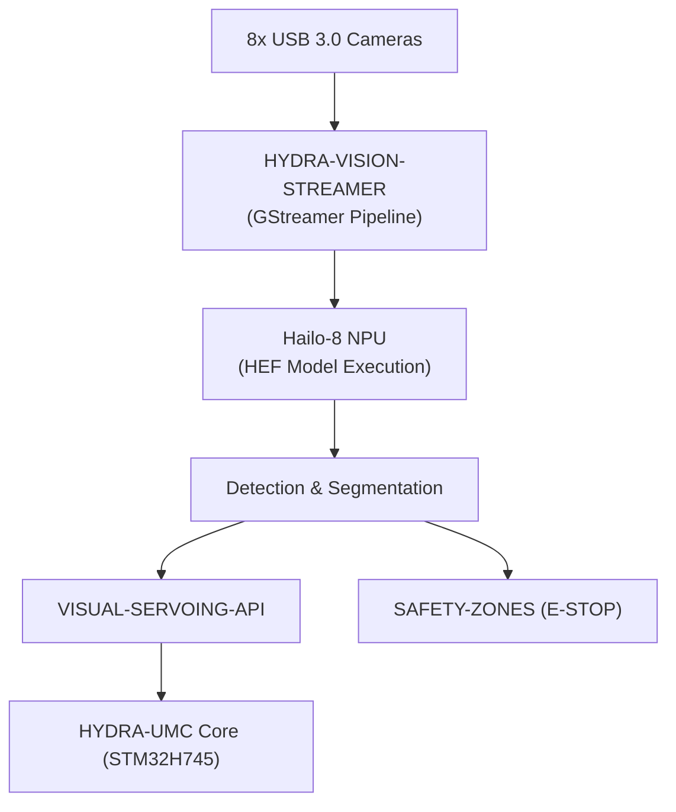

<!-- =============================================================================
HYDRA-UMC-VISION-NODE - Integration parent of the Vision AI Node family
Copyright (C) JuanenRac (Electro Hobby 3D) <electrohobby3d@gmail.com>
GPL-3.0-or-later - see LICENSE
============================================================================= -->

<p align="center">
  
</p>

# 👁️ HYDRA-UMC-VISION-NODE

<p align="center"><a href="README.md">🇺🇸 English</a> | <a href="README_spa.md">🇪🇸 Español</a> | <a href="README_fra.md">🇫🇷 Français</a> | <a href="README_ita.md">🇮🇹 Italiano</a> | <a href="README_deu.md">🇩🇪 Deutsch</a> | <a href="README_zho.md">🇨🇳 简体中文</a> | 🇯🇵 <b>日本語</b> | <a href="README_por.md">🇵🇹 Português</a></p>

### 🧠 高速知覚エッジ AI ノード（Hailo-8 + Raspberry Pi CM5）

<p align="center">
  
  
  
  
  
  
  
</p>

---

> **安全性とセキュリティの現状:** このエコシステムは認証された安全システムではありません。ハードウェアの E-STOP 経路、ファームウェアが強制する制限やインターロック、検証済みの動作コマンドはまだありません。ファームウェアイメージは CRC32 と共有鍵の HMAC-SHA256 で検査しており、非対称署名ではありません。TLS と相互 TLS は任意で、既定では無効です。独自基板はまだ実装も試験もされていません。ここに書かれた内容を人の安全のために頼る前に、[セキュリティベースライン](https://github.com/JuanenRac/HYDRA-UMC-DOCS/blob/main/docs/SECURITY_BASELINE.md)と[脅威モデル](https://github.com/JuanenRac/HYDRA-UMC-DOCS/blob/main/docs/THREAT_MODEL.md)をお読みください。

---

## 📋 ひと目で

| | |
|---|---|
| バージョン | `0.1.6` |
| 成熟度 | 機能する |
| テスト | 98 (`python -m pytest -q tests`) |
| 技術 | Python / CM5 / Hailo-8 |
| 対象 | HYDRA-UMC セルの Raspberry Pi CM5 |
| 実機での確認 | まだです：このバージョンについて実機での動作記録はありません |

**移動：** [概要](#-概要) · [アーキテクチャ](#-アーキテクチャ) · [クイックスタート](#-クイックスタート) · [テスト](#-テスト) · [リポジトリの構成](#-リポジトリの構成) · [関連プロジェクト](#-関連プロジェクト)

## 🚦 プロジェクトの状況

各行はこのリポジトリの一部分で、信号は今日どこまで進んでいるかを示します。計画ではなく、リポジトリが示せるもの（テスト、ビルド、実行）に基づいて書かれています。

🟢 完了・検証済み · 🟡 動作する（既知の制限あり） · 🟠 一部のみ、または未検証 · 🔴 未実装または動作しない

| 領域 | 状態 | ここでの意味 |
|---|---|---|
| ソフトウェア | 🟡 | 主な目的では動作します。足りない点は上の正直さの確認に書かれています |
| テスト | 🟢 | 自動テスト 98 件。変更のたびに実行されます |
| 実機 | 🔴 | まだです：このバージョンについて実機での動作記録はありません |
| ドキュメント | 🟢 | 8 言語の README。変更のたびにマニフェストと照合されます |

## 🎯 概要

**HYDRA-UMC-VISION-NODE** は、HYDRA-UMC エコシステムの専用知覚エンジンです。
Raspberry Pi Compute Module 5 に Hailo-8 M.2 AI アクセラレーターを組み合わせて
実行するよう設計されており、最大 8 台の USB 3.0 カメラからの大量のビデオ
ストリームを同時に処理することを目的としています。

システムの「反射神経」として、物体追跡、欠陥検査、安全監視を、中央のオーケストレーターに負荷をかけずに行うことを目指しています(計画中:これらはまだ Hailo-8 上では動作しておらず、精度も主張しません)。

本プロジェクトは Vision AI Node ファミリーの**統合親プロジェクト**です。
それ自体がすべての作業を行うのではなく、以下の 4 つの専門子プロジェクトが
接続される先のノードであり、それぞれが単一の責任を担います：

* 🔑 **任意の Bearer トークン：** ループバックでは API にトークンは不要で、ループバック以外ではトークンなしでは起動しません（`--token-file` または `HYDRA_UMC_VISION_NODE_TOKEN`）。トークンを設定すると、すべてのリクエストが `Authorization: Bearer <token>` を送る必要があります（一定時間での比較）。マニフェストのヘルスパスである `GET /stats` だけは開いたままです。*(実装済み)*
* **[HYDRA-UMC-VISION-STREAMER](https://github.com/JuanenRac/HYDRA-UMC-VISION-STREAMER)** — 本ノードが消費するカメラフィードをキャプチャし前処理します。
* **[HYDRA-UMC-DETECTION-HEF](https://github.com/JuanenRac/HYDRA-UMC-DETECTION-HEF)** — 本ノードがその Hailo-8 NPU にロードする `.hef` モデルをコンパイルしバージョン管理します。
* **[HYDRA-UMC-SAFETY-ZONES](https://github.com/JuanenRac/HYDRA-UMC-SAFETY-ZONES)** — このノードの知覚を侵入検知と E-STOP 要求に変換することを目指す(v0 ロジックのみ。検出器はまだ接続されていない)。
* **[HYDRA-UMC-VISUAL-SERVOING-API](https://github.com/JuanenRac/HYDRA-UMC-VISUAL-SERVOING-API)** — このノードの知覚を運動学的な姿勢補正に変換することを目指す(カメラによる姿勢推定はまだない)。

### 要点

* 🧩 **ファミリーレディネスチェック（v0）：** 実際の `family-status` サブコマンドが 4 つの実際の子プロジェクトそれぞれの実際の `hydra-umc.project.json` を読み取り、存在/バージョン/成熟度/役割を報告します——自分自身はまだ Hailo-8 ランタイムもカメラパイプラインも動かしていない統合親プロジェクトとして正直な機能です。下記「正直な現状確認」を参照してください。
* 🩺 **パイプラインマニフェスト、フレーム検証、デグレードモード（v0）：** このノードの知覚パイプラインの形状(どのステージがカメラ、アクセラレータ、あるいはどちらも必要としないか)についての実際の、検査可能なマニフェスト、生のフレームバッファに対する実際の構造的破損チェック、そして実際のカメラ/Hailo-8 ハードウェアを正直に探索し、今どのステージが実際に実行可能かを正確に報告する実際のデグレードモード検出——新しい `pipeline-status` と `validate-frame` サブコマンド経由です。
* 🌐 **JSON/HTTP API（v0）：** 実際の `serve` サブコマンドが `family-status`/`pipeline-status`/`validate-frame` を HTTP API として公開します（`GET /family-status`、`GET /pipeline-status`、`POST /validate-frame`、加えて `GET /stats`）——CLI サブコマンドが実行するのと全く同じ関数を、追加の依存関係なしに `http.server` の上で動かします。詳しくは下記の「JSON/HTTP API」と [`docs/CLI_REFERENCE.md`](docs/CLI_REFERENCE.md) を参照してください。
* 🏷️ **基板コードの読み取り:** `POST /read-code?width=W&height=H&channels=N` は生のフレームをボディとして受け取り(`/validate-frame` と同じ形式)、その中の DataMatrix コードを返します。基板上のコードと作業指示の基板を照合するピックアンドプレースのブリッジ向けです。デコーダーは `pylibdmtx` で、初回使用時にインポートされるオプションの依存関係です。入っていない場合、このルートは `503` を返して何をインストールすべきかを伝え、他のルートには影響しません。コードの文字列には上限があります(印字可能な ASCII、最大 256 文字、最大 16 コード)。模擬デコーダーでテスト済み。実際のラベルでは未検証。*(実装済み)*
* 🚀 **ハードウェアアクセラレーション（計画中）：** Hailo-8（26 TOPS）上での HEF モデルのネイティブ実行を目標に設計されています——これらのモデルをコンパイルするツールチェーンは別プロジェクト（[HYDRA-UMC-DETECTION-HEF](https://github.com/JuanenRac/HYDRA-UMC-DETECTION-HEF)）であり、本ノード自体が構築するものではありません。
* 📷 **マルチストリーム処理（計画中）：** [HYDRA-UMC-VISION-STREAMER](https://github.com/JuanenRac/HYDRA-UMC-VISION-STREAMER) が上流でキャプチャした、最大 8 台の高解像度カメラフィードを同時分析します。
* 🎯 **精密知覚（計画中）：** 産業用部品検出のために YOLO 系アーキテクチャを中心に設計されています。
* 🛡️ **アクティブセーフティ（計画中）：** リアルタイムの占有マッピングを [HYDRA-UMC-SAFETY-ZONES](https://github.com/JuanenRac/HYDRA-UMC-SAFETY-ZONES) に供給し、人の侵入を検知します。
* 🧩 **存在理由：** 専用ノードがなければ、知覚処理は [HYDRA-UMC](https://github.com/JuanenRac/HYDRA-UMC) 内部の STM32H745 リアルタイムコア（これに割く余剰サイクルはありません）を過負荷にするか、あるいはすべてのカメラフレームをリモート GPU へ送信せざるを得ず、安全ループが許容できない遅延を追加することになります。ロボット本体のすぐそばで CM5 + Hailo-8 上で実行することで、検知 → 補正 →（必要であれば）E-STOP のループをローカルかつ高速に保ちます。

**正直な現状確認 —— 今日実際に動くもの：** 引数なしの呼び出しは引き続き識別情報/バージョン/役割を表示しますが、今では実際の `family-status [--workspace パス]` サブコマンドもあります：ローカルチェックアウトから `HYDRA-UMC-VISION-STREAMER`/`HYDRA-UMC-DETECTION-HEF`/`HYDRA-UMC-SAFETY-ZONES`/`HYDRA-UMC-VISUAL-SERVOING-API` それぞれの実際のマニフェストを読み取り、見つけたものを正直に報告します。上記で説明した Hailo-8 ランタイム、
gRPC 制御 API、実際の子プロセス監督ロジックはいずれもまだ存在して
いません——それらは本プロジェクトが存在する理由であり、現在行っている
ことではありません。実際に出荷済みの内容は [`CHANGELOG.md`](CHANGELOG.md)
を、まだ残っている作業は下記の「現在の状況と次のステップ」セクションを
参照してください。

**API の制限：** `POST /validate-frame` は、8192x8192x4 または 64 MiB を超えるフレーム（および正でないサイズ）を、ボディを読む前に拒否します。`?workspace=` は、サーバー起動時のワークスペースの内側のみを指定できます。コンテナではワークスペースは `HYDRA_UMC_WORKSPACE` から取得されます（`docker-compose.yml` のように、兄弟リポジトリを読み取り専用で `/workspace` にマウントしてください）。systemd ユニットはカメラとアクセラレーターの検出が動作するよう実際の `/dev` を保持し、`PrivateDevices` の代わりに `DevicePolicy=closed` でデバイスを制限します。

## 🧩 HYDRA-UMC での役割

**HYDRA-UMC-VISION-NODE** は Vision AI Node ファミリーの統合の親です。カメラやアクセラレーター、検出そのものは動かさず、4 つの子が揃って準備できているかを確認し、知覚パイプラインを段階ごとに説明し、生のカメラフレームを検証し、DataMatrix コードを読み取ります。

## 🏛️ アーキテクチャ

<p align="center">
  
</p>

<details>
<summary>図のテキスト版（Mermaid）</summary>



</details>

### 目標システムフロー

下図は、本スケルトンが構築を目指している目標データフローです——これは
今日実行されているパイプラインではなく、アーキテクチャ上の決定事項を
記録したものです。

### 高度な技術情報

### 本プロジェクトが統合親プロジェクトである理由（具体的に何を意味するか）

Vision AI Node ファミリーの 5 つのプロジェクトの中で、本プロジェクトだけが
以下を持っています：

* **`os/`** フォルダ —— CM5 ホスト向けの共有 HydraOS システムイメージ設定。4 つの子プロジェクトは、その 1 つの共有 OS イメージの*上に*プロセス/コンテナとして実行されます。それぞれが独自のコピーを持つ理由はありません。
* **`models/`** フォルダ —— Hailo-8 NPU に実際にロードされ実行される、コンパイル済みの `.hef` モデル。[HYDRA-UMC-DETECTION-HEF](https://github.com/JuanenRac/HYDRA-UMC-DETECTION-HEF) はこれらのモデルが*コンパイルされバージョン管理される*場所であり、本ノードは Hailo-8 デバイスハンドルを保持するプロセスであるため、*実際に配信され実行されているコピー*が存在する場所です。
* **`docker-compose.yml`** —— 下記参照。

5 つのプロジェクトのいずれも `hardware/` や `firmware/` フォルダを持って
いません。CM5 + Hailo-8 は市販のハードウェアであり、[HYDRA-UMC](https://github.com/JuanenRac/HYDRA-UMC) 内部のカスタム STM32H745/STM32G474 基板とは異なり、独自に設計する基板はありません。

### `docker-compose.yml`：統合マップ。子プロジェクト自身の Dockerfile から構築される（ここでは Docker で実行したことはない）

プロジェクトルートの `docker-compose.yml` は、本ノード自身のサービスと
4 つの子プロジェクトすべてを定義し、それぞれが必要とすると想定される
デバイス/ボリューム/ポート（Hailo-8 デバイスノード、カメラごとの V4L2
デバイス、HYDRA-UMC コアへの gRPC ポート）を結び付けています。各要素が
なぜそこにあるのかを説明する詳細なコメントが付いています。4 つの子プロジェクトはいずれも
独自の `Dockerfile` を提供しており、スタックはそれらから構築されますが、**Docker のある環境で構築・
実行されたことは一度もありません**（開発環境にはありません）。その形とコマンドは、
それらの Dockerfile と CM5 の実際の systemd ユニットに照らして手作業で確認しただけです。
これは、統合の形が一度だけ決定・文書化され、各子プロジェクトがばらばらに即興で対応することの
ないようにするために存在します。

### 本スケルトンで既に行われた設計上の決定

* **バージョンはハードコードではなく、インストール済みパッケージのメタデータから読み取られます。** `main.py` はパッケージ内のどこかに 2 つ目の `__version__` 文字列を保持する代わりに `importlib.metadata.version("hydra-umc-vision-node")` を呼び出します。これにより、`bump_version.py` が編集すべき箇所は常に 1 か所（`pyproject.toml`）だけとなり、表示されるバージョンがそれと静かにずれることは決してありません。
** `bump_version.py` は実際のビルドごとに `PATCH` を増加させ、9 を超えると `MINOR` に繰り上がり、`MINOR` も 9 を超えると `MAJOR` に繰り上がりますが、`MAJOR` 自体を自動で増加させることは決してありません。`MAJOR` は意図的な、人間による意味的な決定（実際のアーキテクチャ上のマイルストーン）であり、ビルドスクリプトが自ら決めるべきことではありません。これはエコシステム全体で既に使われている慣例と同じです（`HYDRA-UMC-EDITOR-URDF/bump_version.py` と `HYDRA-UMC-SUITE/bump_version.py` を参照）。
* **計画中の制御 API には REST ではなく gRPC/Protobuf を採用**（上記のバッジ参照）——本ノードが位置する知覚 → 補正 → ファームウェアのループは遅延に敏感であり、同一 LAN 内の他の Python/組み込みサービスと通信するため、gRPC のバイナリフレーミングとストリーミングサポートが JSON-over-HTTP よりも適しているという理由で選択されました。まだ実装されていませんが、コードが実現する前に方向性を明確にするためここに記録しています。
* **`family-status` が手作業で管理するリストではなく、各子プロジェクト自身のマニフェストを読み取る理由。** `hydra-umc.project.json` は、エコシステム全体のダッシュボードとアップデーターがすでに信頼している唯一の真実の情報源です——ここに第 2 のリストを持つと、子プロジェクトの実際の成熟度が変わった瞬間、誰も更新を忘れずに済むとは限らず、すぐに食い違いが生じてしまいます。
* **兄弟プロジェクトのローカルチェックアウトが見つからない場合、実際の正直な「見つかりません」になる理由（クラッシュではなく）。** 統合親プロジェクトは、開発者が実際に 4 つの子プロジェクトすべてをローカルにチェックアウトしているかどうかを本当には知り得ません——`manifest.py` は実際に起こりうるあらゆる失敗（リポジトリなし、マニフェストなし、不正な JSON）に対して `None` を返すため、`family-status` は例外を発生させる代わりにそれを明確に報告します。
* **デグレードモード検出がプローブと純粋な決定関数に分かれている理由。** `hardware.py` の `camera_available()`/`accelerator_available()` は実際のハードウェア(Linux のデバイスノード)に触れる唯一の部分です——`determine_mode()`/`active_stages()` は単純な真偽値だけを受け取り、実際の決定ロジックを含みます。この分離があるからこそ、あらゆる実際のハードウェアの組み合わせ(フル、カメラなし、アクセラレータなし、ハードウェアなし)を、ファイルシステムをモックすることも、ロジックが正しいことを証明するために実際の CM5+Hailo-8 ハードウェアを必要とすることもなく、直接的かつ決定論的にテストできます。
* **フレーム検証が構造のみをチェックし、ピクセル内容をチェックしない理由。** 切り詰められた/サイズ超過のバッファ、あるいは疑わしいほど均一なバッファ(センサーの固着、空白のキャプチャ)を検出することは、参照画像もカメラも必要とせず正直にテストできる、実際の、有用な、ハードウェアに依存しない検証です。フレームの実際の内容がおかしく見えるかどうか(ブレ、露出、実際の映像品質指標)を判断することは、根本的に異なる、はるかに難しい問題であり、校正のために実際にキャプチャされたフレームを必要とします——この v0 では明示的にスコープ外です。

## 🚀 クイックスタート

Python 3.10 以上が必要です。

```bash
./build.sh  # Linux, macOS (build.bat on Windows)
./run.sh family-status
./run.sh pipeline-status
./run.sh validate-frame frame.raw --width 640 --height 480
./run.sh serve --port 8105
```

## 🧪 テスト

`python -m pytest -q tests` で自動テスト 98 件を実行します。 ハードウェアも、このマシンの外にあるものも必要ありません。

CI は `HYDRA_UMC_CI=1 python tools/ci_validate.py` を実行し、マニフェスト、文書、8 つの README、図を検査します。

## 🏗️ ビルドとリリース

### 前提条件

* `PATH` 上に **Python 3.10 以降**があること（`python3`/`python` の両方を試すスクリプトで確認済み）。
* システムレベルの Hailo SDK、GStreamer、その他のネイティブ依存関係は現時点では不要です——**サードパーティのランタイム依存関係が一切ありません**（`pyproject.toml` の `dependencies = []`）。`pytest` は開発専用のエクストラであり、実際のテストスイートのためだけに使用されます。対応する実際のロジックが実装され次第、これらのランタイム依存関係は追加されます。
* ローカル仮想環境用の十分なディスク容量（この段階では `.venv/` 下に作成され、数十 MB 程度です）。

### ステップバイステップ —— 各コマンドが実際に行うこと

```bash
# Linux / macOS
./build.sh
```

1. **バージョンの確認** — プロジェクトのバージョンを読み取って表示します。ビルドがバージョンを変更することはありません（上げるのは `python tools/hydra_project_tool.py bump` だけです）。
2. **仮想環境** — `.venv/` がまだ存在しない場合は作成します（再実行しても安全です。既存の `.venv/` は再作成されず再利用されます）。
3. **Editable インストール（dev エクストラ付き）** — `pip install -e ".[dev]"` は本パッケージを「editable」モードで `.venv` にインストールするため、`src/` 下のソース変更は再インストールなしに即座に反映され、`pytest` がインストールされ、`run.sh` が使用する `hydra-umc-vision-node` コンソールエントリポイントが登録されます。
4. **コンパイルチェック** — `python -m compileall -q src` は `src/` 下のすべての `.py` ファイルをバイトコンパイルし、`main.py` から一度も実際にインポートされないファイルであっても、パッケージ全体にわたる構文エラーを検出します。
5. **実際のテストスイート** — `pytest tests/` が全 98 件のテストを実行します。

スクリプトは `set -euo pipefail` を使用し、最初に失敗したステップで停止
します。すべてのステップが成功した場合にのみ `Build complete.` (`build.sh`) / `== Build OK ==` (`build.bat`) を
表示します。

```bash
./run.sh
```

`.venv` 内の Python インタープリタを特定し（本リポジトリはクロス
プラットフォームで開発されているため、POSIX の `.venv/bin/python` と
Windows 形式の `.venv/Scripts/python.exe` の両方のレイアウトに対応）、
`python -m hydra_umc_vision_node.main` を実行し、あらゆる引数を転送します。

引数なしで呼び出すと名前 + バージョン + 役割を表示します：

```text
HYDRA-UMC-VISION-NODE v0.1.6
High-speed perception edge AI node (Hailo-8 + CM5) - integration parent of Vision-Streamer, Detection-HEF, Safety-Zones and Visual-Servoing-API.
```

実際の `family-status` サブコマンドは、実際のローカルチェックアウトを
確認します：

```bash
./run.sh family-status
./run.sh family-status --workspace /path/to/some/other/checkout

# Windows
run.bat family-status
```

デフォルトでは、本リポジトリ自身の親ディレクトリを使用します——これは
このエコシステムの実際のチェックアウトがすでに使用しているのと同じ
レイアウトです。実際の子プロジェクトが 1 つでも見つからない場合は `1`
で終了します。

実際の `pipeline-status` サブコマンドは実際のハードウェアを探索し、実際の、
正直な結果を報告します：

```bash
./run.sh pipeline-status
```
```json
{
  "manifest": { "version": "0.1.0", "stages": [ "..." ] },
  "camera_present": false,
  "accelerator_present": false,
  "mode": "degraded_no_hardware",
  "runnable_stages": ["preprocess", "postprocess", "publish"],
  "skipped_stages": ["capture", "inference"]
}
```

この開発マシン(CM5 も Hailo-8 もカメラもない)では、これが実際の、正直な
答えです——終了コード `1`(`full` モード以外すべて)。実際の `validate-frame`
サブコマンドは、ディスク上の生のフレームバッファファイルの構造的破損を
チェックします：

```bash
./run.sh validate-frame path/to/frame.raw --width 1920 --height 1080
# Frame OK: path/to/frame.raw matches 1920x1080x3 (6220800 bytes)

./run.sh validate-frame path/to/truncated.raw --width 1920 --height 1080
# Frame INVALID: path/to/truncated.raw
#   [size_mismatch] frame buffer is ... bytes, expected 6220800 bytes ... - likely truncated or corrupt
```

```bat
:: Windows - 手順は同じ、バッチ構文
build.bat
run.bat
```

### JSON/HTTP API

実際の `serve` サブコマンドは、単発の CLI 呼び出しの代わりに `family-status`/`pipeline-status`/`validate-frame` を JSON/HTTP API として実行します——この系列の他の `api.py` ファイルがすでに使っているのと同じ慣習で、標準ライブラリの `http.server`（`ThreadingHTTPServer`）の上に構築されており、追加のランタイム依存はありません。

```bash
./run.sh serve --addr 127.0.0.1 --port 8094
```

| ルート | メソッド | 備考 |
|---|---|---|
| `/family-status` | `GET` | `family-status` サブコマンドと同じです。オプションのクエリパラメータ `?workspace=PATH` はそのリクエストに限りサーバーのデフォルトワークスペースを上書きします。 |
| `/pipeline-status` | `GET` | `pipeline-status` サブコマンドと同じです。 |
| `/read-code` | `POST` | ボディとして送られた生フレーム内の DataMatrix コード。`/validate-frame` と同じく `?width=W&height=H` とオプションの `channels`(既定 3)を指定します。`{"codes": [...], "count": N}` を返し、`pylibdmtx` がなければ `503` を返します。 |
| `/validate-frame` | `POST` | `validate-frame` サブコマンドと同じチェックですが、生のフレームバイト列はサーバー側のファイルパスではなくリクエストボディとして送られます——実際のリモート呼び出し元には、このサーバー自身のファイルシステム上のローカルパスを渡す手段がないためです。`?width=W&height=H` クエリパラメータが必須です（`channels` は省略可、デフォルト `3`）。 |
| `/stats` | `GET` | サーバーのデフォルトワークスペースのパスを報告します。 |

`/validate-frame` の例。上記の CLI の解説と同じ、48 バイトの多様な値を持つフィクスチャを使用しています。

```bash
curl -X POST "http://127.0.0.1:8094/validate-frame?width=4&height=4&channels=3" --data-binary @vn_good_frame.raw
# {"valid": true, "expectedBytes": 48, "actualBytes": 48, "issues": []}
```

どのルートも、サイレントに失敗する代わりに正直なエラー本文（`{"error": "..."}`）と対応する HTTP ステータスを返します——クエリパラメータが不正/不足していれば `400`、未知のパスなら `404` です。ルートごとの完全なリファレンス: [`docs/CLI_REFERENCE.md`](docs/CLI_REFERENCE.md)。

### トラブルシューティング

* **`python`/`python3` が見つからない** — Python 3.10+ をインストールし `PATH` に含まれていることを確認してください。`build.sh` は `python3` を、`build.bat` は `python` を使います。
* **`compileall` が失敗する** — `src/` 下に実際の構文エラーが導入されたことを意味します。ビルドスクリプトは意図的に非ゼロで終了し、インストールの作成/更新は行いません。壊れたパッケージが「ビルド成功」のまま放置されることは決してありません。
* **`run.sh`/`run.bat` が「`.venv` が見つかりません」と表示する** — 先に少なくとも 1 回 `build.sh`/`build.bat` を実行する必要があります。`run.sh`/`run.bat` 自体が環境を作成することはなく、ビルドのみが作成します。
* **変更を取り込んだ後、editable インストールが古いままになる** — `.venv/` を削除して `build.sh`/`build.bat` を再実行してください。`pip install -e .` は通常、再インストールなしにソースの変更を認識するため、これが必要になることはまれです。

## 📂 リポジトリの構成

<p align="center">
  
</p>

<details>
<summary>ツリーのテキスト版</summary>

```text
HYDRA-UMC-VISION-NODE/
├── src/hydra_umc_vision_node/   ソースコード
│   ├── __init__.py              パッケージの説明とバージョン
│   ├── manifest.py              兄弟プロジェクト自身のマニフェストの実際の防御的リーダー
│   ├── family.py                4 つの実際の子プロジェクトに対する実際のファミリーレディネスチェック
│   ├── pipeline.py              実際の知覚パイプラインマニフェスト（ステージ + ハードウェア要件）
│   ├── frame.py                 実際の、ハードウェアに依存しないフレーム破損検証
│   ├── hardware.py              実際のカメラ/アクセラレータ探索 + デグレードモードロジック
│   ├── api.py                   シンプルなJSON/HTTPサーフェス(stdlibのhttp.server)。実際の3つのサブコマンドを橋渡し
│   ├── main.py                  エントリポイント + `family-status`/`pipeline-status`/`validate-frame`
│   ├── access.py                HTTP API 用の任意の Bearer トークン (ループバックでは不要、それ以外では必須)
│   ├── codes.py                 生フレーム内の DataMatrix コードを読む (ピックアンドプレースセル内の基板の識別)
│   └── compat_record.py         検出結果の生成に使ったもの (モデル、バージョン、SHA-256、アーキテクチャ) と、現在も適合するか
├── tests/                       実際のテスト：マニフェスト読み込み、ファミリーステータス、pipeline、frame、hardware、api、CLI
├── docs/                        ドキュメントと API リファレンス
├── images/                      メディアと図表
├── systemd/                     サービスユニット
├── tools/                       プロジェクトのツールと CI の検査
├── .github/                     CI ワークフローと Issue テンプレート
├── pyproject.toml               パッケージのメタデータ
├── bump_version.py              明示的なバージョン更新
├── bump_manifest_version.py     hydra-umc.project.json のバージョンをネイティブ版と同期(--sync)
├── build.sh / build.bat         venv + editable インストール（dev エクストラ付き） + コンパイルチェック + テスト
├── run.sh / run.bat             ローカル venv からエントリポイントを実行（引数を転送）
├── docker-compose.yml           Vision AI Node の 4 つの子プロジェクトの統合マップ（Docker では未検証）
├── CHANGELOG.md                 各バージョンの変更点
├── Dockerfile                   コンテナイメージ
├── build-test.sh                変更を伴わないビルド確認
├── hydra-umc.project.json       マニフェスト：バージョン、成熟度、ファミリー
└── test.sh                      テストを実行
```

</details>

## 🗺️ ロードマップと既知の制限

**現時点の既知の制限**

**今日実現していること：** 実際のファミリーレディネスチェック（`manifest.py`/`family.py`）——4 つの実際の子プロジェクトそれぞれのマニフェストを読み取り、存在/バージョン/成熟度/役割を報告します——、実際のパイプラインマニフェストと実際のデグレードモード検出（`pipeline.py`/`hardware.py`）——実際のカメラ/Hailo-8 ハードウェアを正直に探索し、どのパイプラインステージが実行可能かを正確に報告します——、実際の、ハードウェアに依存しないフレーム破損検証（`frame.py`）、`family-status`/`pipeline-status`/`validate-frame` の各 CLI サブコマンドに加えてこの 3 つを JSON/HTTP API として公開する `serve` サブコマンド（`api.py`）、通過した 98 件のテスト、そして `docker-compose.yml` における 4 つの
子プロジェクトの完全な統合マップの文書化（子プロジェクト自身の Dockerfile から構築され、Docker では実行されていない）——実際の完全なビルド/実行出力は [`CHANGELOG.md`](CHANGELOG.md) を参照してください。

**まだ残っている作業（順不同、確定した期限なし）：**

* 実際の Hailo-8 ランタイム初期化と推論ループ。
* HYDRA-UMC コアへの gRPC 制御 API。
* 4 つの子サービスの実際の監督（現在の `family-status` は存在/成熟度のみを確認し、ランタイムの健全性は確認しません。`docker-compose.yml` は意図された形を文書化しているだけです）。
* [HYDRA-UMC-VISION-STREAMER](https://github.com/JuanenRac/HYDRA-UMC-VISION-STREAMER) が実際のキャプチャパイプラインを持ち次第、マルチカメラパイプラインの同期。
* `docker-compose.yml` を Docker のある環境で実際に構築・実行すること（4 つの子プロジェクトはすでに `Dockerfile` を提供しています）。

## 🌍 言語

この README とリポジトリの文書は、英語・スペイン語・ドイツ語・フランス語・イタリア語・日本語・中国語・ポルトガル語（ポルトガル）の 8 言語で提供されています。8 つのファイルは同時に書かれ、同じ節と同じリンクを持つことを CI が確認します。 このリポジトリには独自の画面もメッセージカタログもないため、翻訳すべきインターフェース文字列はありません。

## 🔗 関連プロジェクト

本プロジェクトは、同じ作者(JuanenRac / Electro Hobby 3D)による HYDRA-UMC ロボティクスエコシステムの一部です。リクエストが実はこの中のどれかについてのものである可能性があるため、知っておく価値があります。

**子プロジェクト** —— いずれも、本ノード自身の Hailo-8 知覚パイプラインにおける特定の段階または利用者です
- **[HYDRA-UMC-DETECTION-HEF](https://github.com/JuanenRac/HYDRA-UMC-DETECTION-HEF)** — Hailo アーキテクチャ/チェックサムによる安全読み込み検証を備えた、実際のコンパイル済みモデルレジストリ。
- **[HYDRA-UMC-VISION-STREAMER](https://github.com/JuanenRac/HYDRA-UMC-VISION-STREAMER)** — 実際の HailoRT 統合境界を持つ、実際の GStreamer パイプライン + MediaMTX 設定生成器。
- **[HYDRA-UMC-SAFETY-ZONES](https://github.com/JuanenRac/HYDRA-UMC-SAFETY-ZONES)** — ファイルから物体位置を受け取る、ゾーン侵入・キャリブレーション鮮度・E-STOP 要求の v0 ロジック。検出器は接続されておらず、物理 E-STOP もまだ配線されていない。
- **[HYDRA-UMC-VISUAL-SERVOING-API](https://github.com/JuanenRac/HYDRA-UMC-VISUAL-SERVOING-API)** — ゾーン状態を条件に承認する Position-Based Visual Servoing 補正則。カメラによる姿勢推定はまだない。

**直接関連**
- **[HYDRA-UMC](https://github.com/JuanenRac/HYDRA-UMC)** — ロボットアームのマザーボードの設計——CM5 ホスト + デュアルコア STM32H745、CAN-OTA/SPI-OTA 経由で最大 8 本のツールアームを統括することを目指す(ファームウェアは初期段階で、実装済みの基板はまだない)。このノードとそのファームウェアの間の知覚/E-STOP ループはまだ存在しない。
- **[HYDRA-UMC-COGNITIVE-NODE](https://github.com/JuanenRac/HYDRA-UMC-COGNITIVE-NODE)** — Hailo-10 コグニティブパイプライン(LLM/VLA/音声オーケストレーション)の統合ハブであり、本ノード自身の知覚出力の直接上位に構築された意味層。

**エコシステムの他のプロジェクト**

*コアハードウェア&プラットフォーム*
- **[HYDRA-UMC-OS](https://github.com/JuanenRac/HYDRA-UMC-OS)** — CM5 向けの再現可能な Raspberry Pi OS プロダクト層——読み取り専用エージェント、検証済み設定/プロファイル、WiFi 初回接続プロビジョニング。
- **[HYDRA-UMC-SDK](https://github.com/JuanenRac/HYDRA-UMC-SDK)** — すべてのブリッジが自身のコマンドを検証する共有 JSON-Schema 契約とソフトウェアのジョブゲート境界(認証済みの安全機能ではない)。
- **[HYDRA-UMC-CONNECTOR-HUB](https://github.com/JuanenRac/HYDRA-UMC-CONNECTOR-HUB)** — 外部マシン用コネクタのための宣言的アダプターマニフェストのレジストリとバリデーター。SDK 自身の契約という発想を外部マシンにまで拡張し、産業用ゲートウェイ系のプロジェクトを置き換えることはありません。

*コアバックエンド&クライアント*
- **[HYDRA-UMC-SERVER](https://github.com/JuanenRac/HYDRA-UMC-SERVER)** — すべての制御クライアントが実際に通信する、本物のヘッドレスバックエンド(REST/WebSocket)。
- **[HYDRA-UMC-STUDIO](https://github.com/JuanenRac/HYDRA-UMC-STUDIO)** — リアルタイムのマルチロボット 3D 可視化を備えたウェブ制御ダッシュボード。
- **[HYDRA-UMC-SUITE](https://github.com/JuanenRac/HYDRA-UMC-SUITE)** — 複数のサーバーを同時に扱えるデスクトップ(PySide6)スウォームコマンドセンター、スタンドアロン実行ファイルとしてパッケージ化。
- **[HYDRA-UMC-ANDROID-CONTROL](https://github.com/JuanenRac/HYDRA-UMC-ANDROID-CONTROL)** — 生体認証ログインとペアリングされた Wear OS コンパニオンを備えたネイティブ Android 制御アプリ。
- **[HYDRA-UMC-IOS-CONTROL](https://github.com/JuanenRac/HYDRA-UMC-IOS-CONTROL)** — リアルタイム WebSocket 同期を備えた iOS/iPadOS 制御アプリ(Flutter)。
- **[HYDRA-UMC-DSI](https://github.com/JuanenRac/HYDRA-UMC-DSI)** — 本体搭載の 7 インチ DSI タッチスクリーン向けネイティブタッチ UI、CM5 自体に組み込み。
- **[HYDRA-UMC-EDITOR-URDF](https://github.com/JuanenRac/HYDRA-UMC-EDITOR-URDF)** — 完成したモデルを STUDIO 自身のカタログへ送信するデスクトップ用グラフィカル URDF 作成/編集ツール。
- **[HYDRA-UMC-EDITOR-STL](https://github.com/JuanenRac/HYDRA-UMC-EDITOR-STL)** — HYDRA-UMC-EDITOR-URDF も編集する同じモデルカタログ内で、実在するパーツを変換/置換/削除/追加するデスクトップ STL モデルエディタ。
- **[HYDRA-UMC-BRIDGE-AMR](https://github.com/JuanenRac/HYDRA-UMC-BRIDGE-AMR)** — VDA 5050 MQTT パブリッシャーによる AGV/AMR フリートの調整境界(エミュレートしたフリートに対してのみテスト済み)。
- **[HYDRA-UMC-BRIDGE-CNC](https://github.com/JuanenRac/HYDRA-UMC-BRIDGE-CNC)** — GRBL ステータス/制御バイトへのアクセスを持つ、CNC セルの高レベルコーディネーター(エミュレーターに対してのみテスト済み)。
- **[HYDRA-UMC-BRIDGE-DROIDS](https://github.com/JuanenRac/HYDRA-UMC-BRIDGE-DROIDS)** — Boston Dynamics Spot コマンド送信機能を持つ、脚型/ヒューマノイドドロイドの調整境界(エミュレーターに対してのみテスト済み)。
- **[HYDRA-UMC-BRIDGE-LASER](https://github.com/JuanenRac/HYDRA-UMC-BRIDGE-LASER)** — キー/筐体/インターロックの GPIO 信号 3 系統を読み取るレーザーセルのコーディネーター(模擬チップに対してのみテスト済み。レーザーの武装や発射はできない)。
- **[HYDRA-UMC-BRIDGE-OPENPNP](https://github.com/JuanenRac/HYDRA-UMC-BRIDGE-OPENPNP)** — OpenPnP ピックアンドプレースの基板フローを安全に統括する高レベルコーディネーター。
- **[HYDRA-UMC-BRIDGE-PRINTER3D](https://github.com/JuanenRac/HYDRA-UMC-BRIDGE-PRINTER3D)** — 実際にゲート制御されたジョブコマンドを持つ、Moonraker/Klipper 3D プリンター向けの安全な調整境界。
- **[HYDRA-UMC-BRIDGE-ROS2](https://github.com/JuanenRac/HYDRA-UMC-BRIDGE-ROS2)** — 遅延インポートの rclpy ROS 2 トランスポートを持つコーディネーター(ROS 2 環境ではまだ実行していない)。
- **[HYDRA-UMC-BRIDGE-UAV](https://github.com/JuanenRac/HYDRA-UMC-BRIDGE-UAV)** — MAVLink コマンド送信機能を持つ、カメラ搭載 UAV の調整境界(エミュレーターに対してのみテスト済み)。

*URTC ツールプラットフォーム*
- **[URTC](https://github.com/JuanenRac/URTC)** — 物理的な Universal Robot Tool Controller 基板向けファームウェア、CAN バス経由の 25 以上のツールプロファイル。
- **[URTC-FLASHER](https://github.com/JuanenRac/URTC-FLASHER)** — URTC 基板用のデスクトップ GUI 書き込みツール、CAN-OTA およびフルチップ SWD/JTAG。
- **[URTC-TESTER](https://github.com/JuanenRac/URTC-TESTER)** — URTC 基板向けのデスクトップ CAN バスライブ診断ツール、ツールプロファイルごとに 1 パネル。
- **[URTC-WEB-STUDIO](https://github.com/JuanenRac/URTC-WEB-STUDIO)** — Web Serial API を使ったブラウザベースの URTC-TESTER の代替、ローカルインストール不要。
- **[URTC-GATEWAY](https://github.com/JuanenRac/URTC-GATEWAY)** — URTC の CAN バスの前に置くゲートウェイ：許可する識別子のリスト、レート制限、セッション鍵。コンピューター上でテスト済みで、実際のバスではまだ試していません。

*コグニティブ AI ノード(Hailo-10)*
- **[HYDRA-UMC-VLA-ENGINE](https://github.com/JuanenRac/HYDRA-UMC-VLA-ENGINE)** — Vision-Language-Action モデル向けの、実際のアクショントークンのエンコード/デコードと軌道生成。
- **[HYDRA-UMC-VOICE-UI](https://github.com/JuanenRac/HYDRA-UMC-VOICE-UI)** — 確認ゲート付きの限定的な Watch リレーを備えた、実際の音声フロントエンド(VAD + 意図解析)。
- **[HYDRA-UMC-SEMANTIC-PLANNER](https://github.com/JuanenRac/HYDRA-UMC-SEMANTIC-PLANNER)** — MCU エラーコードに対する、実際のルールベースのタスク分解と意味的エラー復旧。
- **[HYDRA-UMC-DOCS-QA](https://github.com/JuanenRac/HYDRA-UMC-DOCS-QA)** — このエコシステム自身の Markdown ドキュメントに対する、標準ライブラリのみの実際の TF-IDF 文書検索。
- **[HYDRA-UMC-LOCAL-TECHNICIAN](https://github.com/JuanenRac/HYDRA-UMC-LOCAL-TECHNICIAN)** — エコシステム自身のための、ローカルでポリシーゲート付きのAIメンテナンス技術者 — 観察、診断し、修正を提案する;最上位の2つのリスクレベルは意図的にまだ実装されていない。

*オーケストレーション&スウォーム*
- **[HYDRA-UMC-ORCHESTRATOR](https://github.com/JuanenRac/HYDRA-UMC-ORCHESTRATOR)** — 実際の gRPC/Protobuf ヘルスレポート契約とミッションステートマシンを持つ統合ハブ。
- **[HYDRA-UMC-JOB-DISPATCHER](https://github.com/JuanenRac/HYDRA-UMC-JOB-DISPATCHER)** — 実際の HTTP API 上に構築された、優先度ベースの実際のジョブキュー(重複排除付き)。
- **[HYDRA-UMC-NODE-HEALING](https://github.com/JuanenRac/HYDRA-UMC-NODE-HEALING)** — リトライ/バックオフとアイデンティティ不一致検出を備えた、実際の gRPC ベースのフリートヘルスウォッチドッグ。
- **[HYDRA-UMC-PATH-PLANNER-3D](https://github.com/JuanenRac/HYDRA-UMC-PATH-PLANNER-3D)** — 実際の障害物/ワークスペース衝突検証を備えた、実際の RRT ベースの 3D 経路プランナー。
- **[HYDRA-UMC-SWARM-SYNC](https://github.com/JuanenRac/HYDRA-UMC-SWARM-SYNC)** — 複数セルの収束についてプロパティテストされた、実際の CRDT LWW-Element-Map 状態同期。

*デジタルツイン&シミュレーション*
- **[HYDRA-UMC-TWIN](https://github.com/JuanenRac/HYDRA-UMC-TWIN)** — 実際のバージョン互換性同期契約を持つ、デジタルツインエンジンの統合ハブ。
- **[HYDRA-UMC-HIL-BRIDGE](https://github.com/JuanenRac/HYDRA-UMC-HIL-BRIDGE)** — シミュレーションと実機の間にソフトウェアの衝突インターロックを備えたハードウェア・イン・ザ・ループのルーター(実機なしでテスト済み)。
- **[HYDRA-UMC-PHYSICS-REPLICA](https://github.com/JuanenRac/HYDRA-UMC-PHYSICS-REPLICA)** — 実際の URDF サブセットに対する、実際の順運動学と関節限界検証。
- **[HYDRA-UMC-SYNTHETIC-DATA-GEN](https://github.com/JuanenRac/HYDRA-UMC-SYNTHETIC-DATA-GEN)** — YOLO/COCO アノテーションのエクスポート機能を持つ、実際のプロシージャル 2D シーンジェネレーター。

*データ&分析*
- **[HYDRA-UMC-DATALAKE](https://github.com/JuanenRac/HYDRA-UMC-DATALAKE)** — 実際の取り込み/クエリ HTTP API を備えた、実際の sqlite3 ベースの時系列ストア。
- **[HYDRA-UMC-ANOMALY-DETECTOR](https://github.com/JuanenRac/HYDRA-UMC-ANOMALY-DETECTOR)** — ドリフト監視を備えた、実際の FFT + 統計ベースラインによる異常検知器。
- **[HYDRA-UMC-PRODUCTION-REPORTS](https://github.com/JuanenRac/HYDRA-UMC-PRODUCTION-REPORTS)** — DATALAKE の履歴に対する実際の OEE/稼働率計算、再現可能な CSV エクスポート付き。
- **[HYDRA-UMC-TELEMETRY-COLLECTOR](https://github.com/JuanenRac/HYDRA-UMC-TELEMETRY-COLLECTOR)** — シーケンス重複排除機能を備えた、DATALAKE への実際の CAN/WebSocket 取り込みパイプライン。

*産業用ゲートウェイ*
- **[HYDRA-UMC-GATEWAY-INDUSTRIAL](https://github.com/JuanenRac/HYDRA-UMC-GATEWAY-INDUSTRIAL)** — 実際のコマンド許可リスト/バックプレッシャー層を持つ、産業用プロトコルへ中継する統合ハブ。
- **[HYDRA-UMC-OPCUA-SERVER](https://github.com/JuanenRac/HYDRA-UMC-OPCUA-SERVER)** — 実際のバイナリプロトコルクライアントセッションで検証された、実際の OPC-UA アドレス空間。
- **[HYDRA-UMC-MQTT-BROKER](https://github.com/JuanenRac/HYDRA-UMC-MQTT-BROKER)** — クライアント単位のオプション認証とトピック ACL を備えた、実際の MQTT ブローカー。
- **[HYDRA-UMC-MTCONNECT-ADAPTER](https://github.com/JuanenRac/HYDRA-UMC-MTCONNECT-ADAPTER)** — 縮退モード出力を備えた、実際の MTConnect `/probe` および `/current` XML エンドポイント。

*補完ツール&エコシステム運用*
- **[HYDRA-UMC-DASHBOARD-AI](https://github.com/JuanenRac/HYDRA-UMC-DASHBOARD-AI)** — 誠実な統計フォールバックを備えた、DATALAKE/ANOMALY-DETECTOR 上のスマートサマリーと異常ハイライトパネル。
- **[HYDRA-UMC-TOOL-CLI](https://github.com/JuanenRac/HYDRA-UMC-TOOL-CLI)** — 実際の安定した終了コード契約を持つフリート CLI、HYDRA-UMC-SERVER 自身の API の本物のライブクライアント。
- **[HYDRA-UMC-WATCH](https://github.com/JuanenRac/HYDRA-UMC-WATCH)** — 触覚アラートのパターンとペアリング済みスマートフォンへの音声リレーを備えた WearOS コンパニオンアプリ(物理的なウォッチではまだ実行していない)。
- **[URTC-SMART-RACK](https://github.com/JuanenRac/URTC-SMART-RACK)** — 実際の工具 ID デコードと Smart Idle 予熱ロジックを備えた、基板搭載ラック用ファームウェア。
- **[URTC-VISION-TOOL](https://github.com/JuanenRac/URTC-VISION-TOOL)** — サーマル/RGB 検査ツールヘッド向けの、ファームウェアと実際の Python ビジョンコンパニオン。
- **[HYDRA-UMC-UPDATER](https://github.com/JuanenRac/HYDRA-UMC-UPDATER)** — このエコシステム内のすべてのリポジトリを検出・クローン・更新する、管理用デスクトップツール。
- **[HYDRA-UMC-OS-REBUILDER](https://github.com/JuanenRac/HYDRA-UMC-OS-REBUILDER)** — エコシステムの最新バージョンをプリロードした、書き込み可能なCM5イメージを構築するWindows/Linuxデスクトップツール。Raspberry Pi Imager方式の初回起動Wi-Fi/ユーザー/SSH設定を備える。
- **[HYDRA-UMC-OPS-AGENT](https://github.com/JuanenRac/HYDRA-UMC-OPS-AGENT)** — 保守インシデントコーディネーター: 低権限のエッジ役割がサニタイズされたインベントリ/ヘルスのスナップショットを収集し、コントロールプレーン役割がそれを読み取り専用でレンダリングして AI プロバイダーに診断の提案を依頼します - パッチを適用することも、何かをデプロイすることも決してありません。
- **[HYDRA-UMC-DEV-SERVER](https://github.com/JuanenRac/HYDRA-UMC-DEV-SERVER)** — 再現可能な開発ホスト（Raspberry Pi 5 / CM5）。エコシステムのソースコードを保管し、永続キューのもとで境界の明確なビルド/テストタスクを実行する。運用中の CM5 とは明確に異なる、開発専用の役割。

## 📚 ドキュメント

さらに読むには：

* **[docs/CLI_REFERENCE.md](docs/CLI_REFERENCE.md)** —— 各サブコマンド（`family-status`、`pipeline-status`、`validate-frame`、`serve`）と JSON/HTTP API の各ルート、実際に取得した出力付き。
* [エコシステムのセキュリティ基準](https://github.com/JuanenRac/HYDRA-UMC-DOCS/blob/main/docs/SECURITY_BASELINE.md)
* [エコシステムの脅威モデル](https://github.com/JuanenRac/HYDRA-UMC-DOCS/blob/main/docs/THREAT_MODEL.md)
* [このリポジトリの変更履歴](CHANGELOG.md)
* [このリポジトリのライセンス](LICENSE.md)

## 🤝 コントリビュートとコミュニティ

* プルリクエストの前に `HYDRA_UMC_CI=1 py -3 tools/ci_validate.py`（または `HYDRA_UMC_CI=1 python3 tools/ci_validate.py`）を実行してください。`CI_VALIDATION=PASS` と表示される必要があります。この確認に `build.sh` や `build.bat` は使わないでください。ビルドは検査ではありません。
* 8 つの README は HYDRA-UMC-DOCS の 1 つのソースから書かれます。手で編集しないでください。ソースを変更し、`tools/make_readmes.py` で書き直します。
* 実行していないことを README に書かないでください。事実であれば「シミュレーションのみ」「実機では未確認」と書きます。
* [CONTRIBUTING.md](CONTRIBUTING.md)、[行動規範](CODE_OF_CONDUCT.md)、[SECURITY.md](SECURITY.md)、[SUPPORT.md](SUPPORT.md) を参照してください。

## 👤 作者

**JuanenRac (Electro Hobby 3D)** · electrohobby3d@gmail.com

## 📜 ライセンス

GPL-3.0-or-later - [LICENSE](LICENSE).
