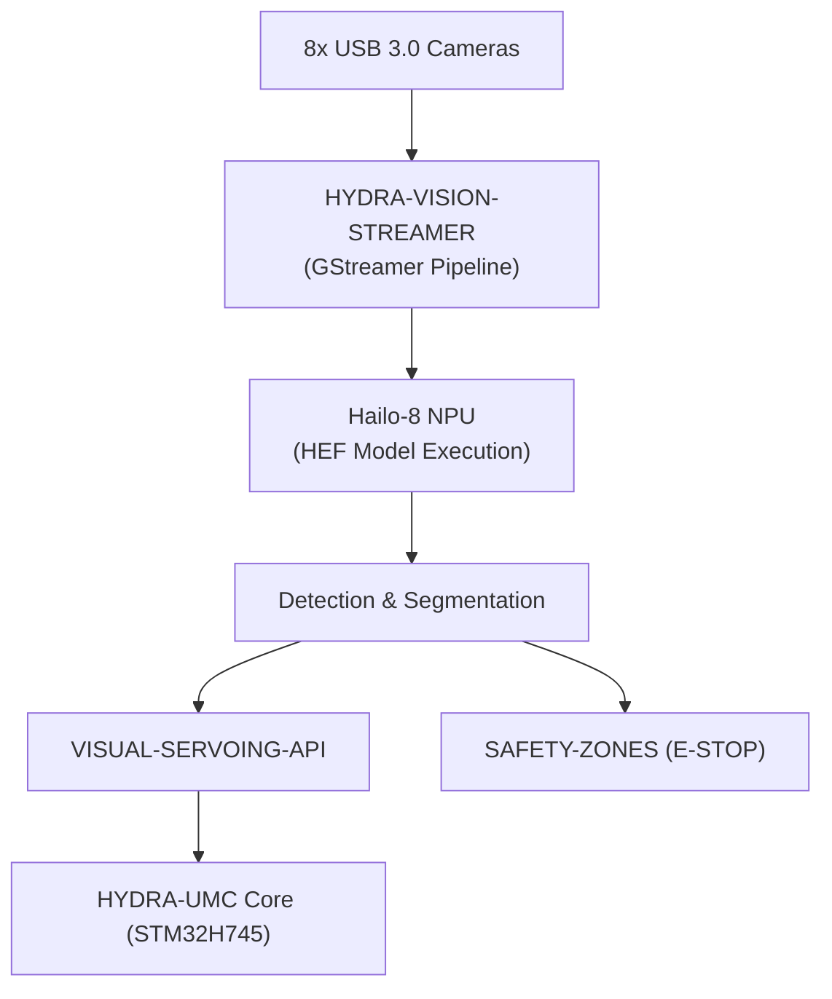

<p align="center">
  
</p>

# 👁️ HYDRA-UMC-VISION-NODE

<p align="center"><a href="README.md">🇺🇸 English</a> | <a href="README_spa.md">🇪🇸 Español</a> | <a href="README_fra.md">🇫🇷 Français</a> | <a href="README_ita.md">🇮🇹 Italiano</a> | <a href="README_deu.md">🇩🇪 Deutsch</a> | <a href="README_zho.md">🇨🇳 简体中文</a> | <a href="README_jpn.md">🇯🇵 日本語</a> | 🇵🇹 <b>Português</b></p>

### 🧠 Nó de IA de periferia para perceção de alta velocidade (Hailo-8 + Raspberry Pi CM5)

<p align="center">
  
  
  
  
  
</p>

---

> **Estado de segurança (safety e security):** este ecossistema não é um sistema de segurança certificado. Ainda não existe um caminho de E-STOP por hardware, nem limites ou interlocks impostos pelo firmware, nem um comando de movimento verificado; as imagens de firmware são verificadas com CRC32 e um HMAC-SHA256 de chave partilhada, não com uma assinatura assimétrica; TLS e TLS mútuo são opcionais e estão desativados por defeito; nenhuma placa própria foi ainda montada ou testada. Leia a [base de segurança](https://github.com/JuanenRac/HYDRA-UMC-DOCS/blob/main/docs/SECURITY_BASELINE.md) e o [modelo de ameaças](https://github.com/JuanenRac/HYDRA-UMC-DOCS/blob/main/docs/THREAT_MODEL.md) antes de confiar em qualquer afirmação aqui para a segurança de uma pessoa.

## 📋 Num relance

| | |
|---|---|
| Versão | `0.1.5` |
| Maturidade | Funcional |
| Tecnologia | Python / CM5 / Hailo-8 |
| Destino | O Raspberry Pi CM5 de uma célula HYDRA-UMC |
| Em hardware real | Ainda não: não há registo de execução em hardware real para esta versão |

## 1. 🛠️ VISÃO TÉCNICA GERAL

O **HYDRA-UMC-VISION-NODE** é o motor de perceção dedicado do ecossistema HYDRA-UMC. Pensado para correr no Raspberry Pi Compute Module 5 emparelhado com um acelerador de IA Hailo-8 M.2, o seu trabalho previsto é tratar fluxos de vídeo massivos de até 8 câmaras USB 3.0 em simultâneo.

Destina-se a ser os «reflexos» do sistema: seguimento de objetos, inspeção de defeitos e vigilância de segurança sem sobrecarregar o orquestrador central (previsto: nada disto corre ainda num Hailo-8 e não se afirma nenhuma precisão).

Este projeto é o **pai de integração** da família do Nó de IA de Visão: não faz ele próprio todo esse trabalho, é o nó a que os 4 filhos especializados abaixo se ligam, cada um com uma única responsabilidade:

* **[HYDRA-UMC-VISION-STREAMER](https://github.com/JuanenRac/HYDRA-UMC-VISION-STREAMER)** — capta e pré-processa os fluxos das câmaras que este nó consome.
* **[HYDRA-UMC-DETECTION-HEF](https://github.com/JuanenRac/HYDRA-UMC-DETECTION-HEF)** — compila e versiona os modelos `.hef` que este nó carrega na sua NPU Hailo-8.
* **[HYDRA-UMC-SAFETY-ZONES](https://github.com/JuanenRac/HYDRA-UMC-SAFETY-ZONES)** — destina-se a transformar a perceção deste nó em deteção de intrusão e pedidos de E-STOP (só lógica v0; nenhum detetor a alimenta ainda).
* **[HYDRA-UMC-VISUAL-SERVOING-API](https://github.com/JuanenRac/HYDRA-UMC-VISUAL-SERVOING-API)** — destina-se a transformar a perceção deste nó em correções cinemáticas de pose (ainda sem estimativa de pose por câmara).

### Pontos principais

* 🧩 **Verificação de prontidão da família (v0):** o subcomando real `family-status` lê o `hydra-umc.project.json` de cada um dos 4 filhos reais e reporta presença/versão/maturidade/papel - honesto para um pai de integração que ainda não executa nenhum ambiente de execução do Hailo-8 nem pipeline de câmaras. Veja a "Verificação de honestidade" abaixo.
* 🩺 **Manifesto do pipeline, validação de tramas e modo degradado (v0):** um manifesto real e inspecionável da forma do pipeline de perceção deste nó (que etapas precisam de uma câmara, de um acelerador ou de nenhum dos dois), verificação estrutural real de corrupção de um buffer de trama em bruto e deteção real de modo degradado que sonda honestamente a existência de hardware de câmara/Hailo-8 e reporta exatamente que etapas podem correr agora - através dos novos subcomandos `pipeline-status` e `validate-frame`.
* 🌐 **API JSON/HTTP (v0):** o subcomando real `serve` expõe `family-status`/`pipeline-status`/`validate-frame` como uma API HTTP (`GET /family-status`, `GET /pipeline-status`, `POST /validate-frame`, mais `GET /stats`) - exatamente as mesmas funções que os subcomandos da CLI executam, sobre `http.server` sem dependências extra. Veja "A API JSON/HTTP" abaixo e o [`docs/CLI_REFERENCE.md`](docs/CLI_REFERENCE.md).
* 🚀 **Aceleração por hardware (planeado):** o desenho visa a execução nativa de modelos HEF no Hailo-8 (26 TOPS) - a cadeia de ferramentas que compila esses modelos é um projeto à parte ([HYDRA-UMC-DETECTION-HEF](https://github.com/JuanenRac/HYDRA-UMC-DETECTION-HEF)), não algo que este nó construa.
* 📷 **Processamento multifluxo (planeado):** análise simultânea de até 8 fluxos de câmaras de alta resolução, captados a montante pelo [HYDRA-UMC-VISION-STREAMER](https://github.com/JuanenRac/HYDRA-UMC-VISION-STREAMER).
* 🎯 **Perceção de precisão (planeado):** desenhado em torno de arquiteturas da família YOLO para a deteção de componentes industriais.
* 🛡️ **Segurança ativa (planeado):** mapeamento de ocupação em tempo real que alimenta o [HYDRA-UMC-SAFETY-ZONES](https://github.com/JuanenRac/HYDRA-UMC-SAFETY-ZONES) para a deteção de intrusão humana.
* 🧩 **Porque existe:** sem um nó dedicado, o trabalho de perceção sobrecarregaria o núcleo de tempo real STM32H745 dentro do [HYDRA-UMC](https://github.com/JuanenRac/HYDRA-UMC) (que não tem ciclos livres para isso) ou obrigaria a enviar cada trama de câmara por cabo para uma GPU remota, somando uma latência que o ciclo de segurança não pode permitir. Correr num CM5 + Hailo-8, fisicamente ao lado do robô, mantém o ciclo detetar → corrigir → (se necessário) E-STOP local e rápido.

**Verificação de honestidade - o que realmente funciona hoje:** a invocação simples continua a imprimir identidade/versão/papel, mas existe agora um subcomando real `family-status [--workspace PATH]`: lê os manifestos reais de `HYDRA-UMC-VISION-STREAMER`/`HYDRA-UMC-DETECTION-HEF`/`HYDRA-UMC-SAFETY-ZONES`/`HYDRA-UMC-VISUAL-SERVOING-API` a partir de uma cópia local e reporta honestamente o que encontra. Nada do ambiente de execução do Hailo-8, da API de controlo gRPC nem da supervisão real dos filhos existe ainda - são a razão de este projeto existir, não algo que faça atualmente. Veja o [`CHANGELOG.md`](CHANGELOG.md) para saber exatamente o que foi entregue até agora e a secção "Estado atual e próximos passos" abaixo para o que continua em aberto.

**Limites da API:** `POST /validate-frame` recusa frames acima de 8192x8192x4 ou 64 MiB (e tamanhos não positivos) antes de ler o corpo, e `?workspace=` só pode apontar para dentro do workspace com que o servidor foi iniciado. Num contentor, o workspace vem de `HYDRA_UMC_WORKSPACE` (monte os repositórios irmãos só de leitura em `/workspace`, como faz o `docker-compose.yml`). A unidade systemd mantém o `/dev` real para que as sondas de câmara e acelerador funcionem, limitando os dispositivos com `DevicePolicy=closed` em vez de `PrivateDevices`.

---

## 2. 🔄 FLUXO PREVISTO DO SISTEMA

O diagrama abaixo é o fluxo de dados de destino para que este esqueleto está a ser construído - documenta a decisão de arquitetura, não um pipeline que corra hoje.



---

## 3. 🧠 INFORMAÇÃO TÉCNICA AVANÇADA

### Porque este projeto é o pai de integração (e o que isso significa em concreto)

Dos 5 projetos da família do Nó de IA de Visão, este é o único que:

* Leva uma pasta **`os/`** — a configuração da imagem de sistema HydraOS partilhada para o anfitrião CM5. Os 4 filhos correm como processos/contentores *por cima* dessa única imagem de sistema; não há motivo para cada um levar uma cópia própria.
* Leva uma pasta **`models/`** — os modelos `.hef` compilados realmente carregados na NPU Hailo-8 em tempo de execução. O [HYDRA-UMC-DETECTION-HEF](https://github.com/JuanenRac/HYDRA-UMC-DETECTION-HEF) é onde esses modelos são *compilados e versionados*; este nó é onde vive a *cópia servida e em execução*, porque é o processo que detém o identificador do dispositivo Hailo-8.
* Leva o **`docker-compose.yml`** — veja abaixo.

Nenhum dos 5 projetos leva uma pasta `hardware/` ou `firmware/`: o CM5 + Hailo-8 é hardware comercial, sem placa própria para desenhar, ao contrário (por exemplo) das placas STM32H745/STM32G474 à medida dentro do [HYDRA-UMC](https://github.com/JuanenRac/HYDRA-UMC).

### `docker-compose.yml`: o mapa de integração, construído a partir dos Dockerfiles dos próprios filhos (nunca executado com Docker aqui)

O `docker-compose.yml` na raiz do projeto define o serviço próprio deste nó mais todos os 4 filhos, ligados com os dispositivos/volumes/portas que cada um deverá precisar (o nó de dispositivo do Hailo-8, os dispositivos V4L2 por câmara, as portas gRPC para o núcleo HYDRA-UMC). Está muito comentado, a explicar *porque* cada peça lá está. Os 4 filhos trazem agora o seu próprio `Dockerfile` e o stack é construído a partir deles, mas **nunca foi construído nem executado num ambiente com Docker** (no ambiente de desenvolvimento não há nenhum): a sua forma e os seus comandos foram conferidos à mão com esses Dockerfiles e com as unidades systemd reais do CM5. Existe para que a forma da integração seja decidida e documentada uma só vez, em vez de improvisada separadamente por cada filho.

### Decisões de desenho já tomadas neste esqueleto

* **Versão lida dos metadados do pacote instalado, não fixada no código.** O `main.py` chama `importlib.metadata.version("hydra-umc-vision-node")` em vez de manter uma segunda cadeia `__version__` algures no pacote. Isto significa que o `bump_version.py` só tem um sítio para editar (`pyproject.toml`), e que a versão impressa nunca pode divergir em silêncio dela.
* **A subida ao estilo conta-quilómetros só toca automaticamente em `PATCH`/`MINOR`.** O `bump_version.py` incrementa o `PATCH` em cada compilação real, transitando para o `MINOR` depois de 9, e o `MINOR` para o `MAJOR` depois de 9 - mas nunca sobe o próprio `MAJOR`. O `MAJOR` é uma decisão deliberada, humana e semântica (um marco de arquitetura real), não algo que um script de compilação deva decidir por si. É a mesma convenção já usada em todo o ecossistema (veja `HYDRA-UMC-EDITOR-URDF/bump_version.py` e `HYDRA-UMC-SUITE/bump_version.py`).
* **gRPC/Protobuf, e não REST, para a API de controlo planeada** (veja o distintivo acima) - escolhido porque o ciclo perceção → correção → firmware em que este nó se encontra é sensível à latência e fala com outros serviços Python/embebidos dentro da mesma LAN, onde o enquadramento binário e o suporte de fluxos do gRPC se ajustam melhor do que JSON sobre HTTP. Ainda não implementado; documentado aqui para que a direção fique clara antes de o código chegar.
* **O `family-status` lê o manifesto próprio de cada filho em vez de uma lista mantida à mão.** O `hydra-umc.project.json` já é a única fonte de verdade em que o painel/atualizador do ecossistema confiam - uma segunda lista aqui divergiria no momento em que a maturidade real de um filho mudasse e ninguém se lembrasse de a atualizar.
* **Uma cópia de irmão em falta é um "não encontrado" real e honesto e não uma falha.** Um pai de integração genuinamente não pode saber se um programador tem os 4 filhos clonados localmente - o `manifest.py` devolve `None` para todos os modos de falha reais (repositório em falta, ficheiro em falta, JSON malformado) para que o `family-status` o possa reportar com clareza em vez de lançar um erro.
* **Porque a deteção de modo degradado se divide numa sonda e numa função de decisão pura.** O `camera_available()`/`accelerator_available()` do `hardware.py` são as únicas partes que alguma vez tocam em hardware real (um nó de dispositivo Linux); o `determine_mode()`/`active_stages()` recebem booleanos simples e contêm a lógica de decisão propriamente dita. Essa separação é o que permite testar de forma direta e determinística cada combinação real de hardware (completo, sem câmara, sem acelerador, sem nenhum hardware), sem simular um sistema de ficheiros nem precisar de hardware CM5+Hailo-8 real para provar a lógica correta.
* **Porque a validação de tramas só verifica a estrutura e não o conteúdo dos píxeis.** Detetar um buffer truncado/sobredimensionado ou suspeitamente uniforme (um sensor congelado, uma captura em branco) é uma validação real, útil e independente do hardware, que não precisa de imagem de referência nem de câmara para ser testada com honestidade. Decidir se o CONTEÚDO real de uma trama parece errado (desfoque, exposição, uma métrica real de qualidade de visão) é um problema fundamentalmente diferente e muito mais difícil, que precisaria de tramas reais captadas para calibrar - explicitamente fora do âmbito desta v0.

---

## 📂 ESTRUTURA DE DIRETÓRIOS

```text
HYDRA-UMC-VISION-NODE/
├── src/hydra_umc_vision_node/
│   ├── manifest.py       # Leitor real e defensivo do manifesto próprio de um irmão
│   ├── family.py          # Verificação real de prontidão da família sobre os 4 filhos reais
│   ├── pipeline.py          # Manifesto real do pipeline de perceção (etapas + necessidades de hardware)
│   ├── frame.py               # Validação real, independente do hardware, de corrupção de tramas
│   ├── hardware.py              # Sondas reais de câmara/acelerador + lógica de modo degradado
│   ├── api.py                     # Superfície JSON/HTTP simples (http.server da biblioteca padrão) sobre os 3 subcomandos reais
│   └── main.py                    # Ponto de entrada + `family-status`/`pipeline-status`/`validate-frame`
├── tests/               # Testes reais: leitura de manifestos, estado da família, pipeline, trama, hardware, api, CLI
├── docs/                # Documentação e referência da API
├── os/                  # Configuração da imagem de sistema HydraOS (CM5) - só no pai, preenchida na implementação (não está no git)
├── models/              # Modelos .hef compilados servidos à NPU Hailo-8 - só no pai, preenchidos na implementação (não estão no git)
├── build/               # Saída da compilação (o .venv local também vive aqui)
├── images/              # Multimédia e diagramas
├── systemd/
│   └── hydra-umc-vision-node.service # Unidade systemd da API local de perceção do CM5
├── tools/
│   ├── build_test.py    # Verificação de compilação sem subir a versão
│   └── ci_validate.py   # Validação de manifesto/CHANGELOG/documentação usada pelo CI
├── pyproject.toml       # Metadados do pacote, dependências, versão ao estilo conta-quilómetros
├── bump_version.py      # Subida de versão nativa ao estilo conta-quilómetros (executada pelo build.sh/.bat)
├── bump_manifest_version.py # Sincroniza a versão do hydra-umc.project.json com a nativa (--sync)
├── build.sh / build.bat # venv + instalação editável (extras de desenvolvimento) + verificação de compilação + testes
├── run.sh / run.bat     # Executa o ponto de entrada a partir do venv local (reencaminha argumentos)
├── docker-compose.yml   # Mapa de integração dos 4 filhos do Nó de IA de Visão (não verificado com Docker)
└── CHANGELOG.md         # Histórico versão a versão (esquema conta-quilómetros, sem datas)
```

`hardware/` e `firmware/` não existem neste repositório (veja "Informação técnica avançada" acima para saber porquê). O `os/` e o `models/` existem apenas neste projeto entre os 5 - os 4 filhos não levam cópias próprias.

---

## 🏗️ GUIA DE COMPILAÇÃO E EXECUÇÃO

### Pré-requisitos

* **Python 3.10 ou superior** no seu `PATH` (verificado através de `python3`/`python` - os scripts tentam ambos).
* Não é necessário nenhum SDK Hailo de sistema, GStreamer ou outra dependência nativa por agora - **zero dependências de execução de terceiros** (`dependencies = []` no `pyproject.toml`); o `pytest` é um extra só de desenvolvimento, usado unicamente pela suite de testes real. Essas dependências de execução serão acrescentadas quando a lógica real correspondente chegar.
* Espaço em disco suficiente para um ambiente virtual local (criado em `.venv/`, algumas dezenas de MB nesta fase).

### Passo a passo - o que cada comando realmente faz

```bash
# Linux / macOS
./build.sh
```

1. **Subida de versão ao estilo conta-quilómetros** — executa o `bump_version.py`, que incrementa o `PATCH` no `pyproject.toml` (transitando para `MINOR`/`MAJOR` segundo a regra acima). Isto acontece em *todas* as compilações, incluindo a que está prestes a executar, por isso espere que a versão suba 1.
2. **Ambiente virtual** — cria o `.venv/` se ainda não existir (seguro voltar a executar; um `.venv/` existente é reutilizado, não recriado).
3. **Instalação editável (com extras de desenvolvimento)** — o `pip install -e ".[dev]"` instala este pacote no `.venv` em modo "editável", para que as edições em `src/` tenham efeito de imediato sem reinstalar, traz o `pytest` e regista o ponto de entrada de consola `hydra-umc-vision-node` usado pelo `run.sh`.
4. **Verificação de compilação** — `python -m compileall -q src` compila para bytecode todos os ficheiros `.py` de `src/`, apanhando erros de sintaxe em todo o pacote mesmo em ficheiros nunca importados pelo `main.py`.
5. **Suite de testes real** — `pytest tests/` executa todos os 66 testes.

O script usa `set -euo pipefail` e pára no primeiro passo que falhar, imprimindo `== Build OK ==` apenas se todos os passos tiverem êxito.

```bash
./run.sh
```

Localiza o interpretador Python dentro do `.venv` (trata tanto a estrutura POSIX `.venv/bin/python` como a ao estilo Windows `.venv/Scripts/python.exe`, já que este repositório é desenvolvido em várias plataformas) e executa `python -m hydra_umc_vision_node.main`, reencaminhando quaisquer argumentos.

A invocação simples imprime nome + versão + papel:

```text
HYDRA-UMC-VISION-NODE v0.1.5
High-speed perception edge AI node (Hailo-8 + CM5) - integration parent of Vision-Streamer, Detection-HEF, Safety-Zones and Visual-Servoing-API.
```

O subcomando real `family-status` verifica a cópia local real:

```bash
./run.sh family-status
./run.sh family-status --workspace /path/to/some/other/checkout

# Windows
run.bat family-status
```

Por omissão usa o diretório pai deste próprio repositório - a estrutura real de cópias irmãs que este ecossistema já usa. Termina com `1` se algum filho real estiver em falta.

O subcomando real `pipeline-status` sonda o hardware real e reporta o resultado real e honesto:

```bash
./run.sh pipeline-status
```
```json
{
  "manifest": { "version": "0.1.0", "stages": [ "..." ] },
  "camera_present": false,
  "accelerator_present": false,
  "mode": "degraded_no_hardware",
  "runnable_stages": ["preprocess", "postprocess", "publish"],
  "skipped_stages": ["capture", "inference"]
}
```

Nesta máquina de desenvolvimento (sem CM5, sem Hailo-8, sem câmara) essa é a resposta real e honesta - código de saída `1` (tudo o que não seja o modo `full`). O subcomando real `validate-frame` verifica a corrupção estrutural de um ficheiro de buffer de trama em bruto:

```bash
./run.sh validate-frame path/to/frame.raw --width 1920 --height 1080
# Frame OK: path/to/frame.raw matches 1920x1080x3 (6220800 bytes)

./run.sh validate-frame path/to/truncated.raw --width 1920 --height 1080
# Frame INVALID: path/to/truncated.raw
#   [size_mismatch] frame buffer is ... bytes, expected 6220800 bytes ... - likely truncated or corrupt
```

```bat
:: Windows - passos idênticos, sintaxe batch
build.bat
run.bat
```

### A API JSON/HTTP

O subcomando real `serve` executa `family-status`/`pipeline-status`/`validate-frame` como uma API JSON/HTTP simples em vez de uma chamada única da CLI - a mesma convenção que os outros ficheiros `api.py` desta família já usam, construída sobre o `http.server` (`ThreadingHTTPServer`) da biblioteca padrão, sem dependência extra de execução:

```bash
./run.sh serve --addr 127.0.0.1 --port 8094
```

| Rota | Método | Notas |
|---|---|---|
| `/family-status` | `GET` | O mesmo que o subcomando `family-status`. O parâmetro opcional `?workspace=PATH` substitui o espaço de trabalho por omissão do servidor para esse único pedido. |
| `/pipeline-status` | `GET` | O mesmo que o subcomando `pipeline-status`. |
| `/validate-frame` | `POST` | A mesma verificação do subcomando `validate-frame`, mas os bytes da trama em bruto viajam como corpo do pedido em vez de um caminho de ficheiro do servidor - quem chama remotamente não tem um caminho local no sistema de ficheiros deste servidor para lhe entregar. Exige os parâmetros `?width=W&height=H` (`channels` opcional, por omissão `3`). |
| `/stats` | `GET` | Reporta o caminho do espaço de trabalho por omissão do próprio servidor. |

Exemplo de `/validate-frame`, com o mesmo conjunto variado de 48 bytes do percurso da CLI acima:

```bash
curl -X POST "http://127.0.0.1:8094/validate-frame?width=4&height=4&channels=3" --data-binary @vn_good_frame.raw
# {"valid": true, "expectedBytes": 48, "actualBytes": 48, "issues": []}
```

Cada rota responde com um corpo de erro honesto (`{"error": "..."}`) e o estado HTTP correspondente - `400` para parâmetros inválidos/em falta, `404` para um caminho desconhecido - em vez de falhar em silêncio. Referência completa rota a rota: [`docs/CLI_REFERENCE.md`](docs/CLI_REFERENCE.md).

### Resolução de problemas

* **`python`/`python3` não encontrado** — instale o Python 3.10+ e confirme que está no `PATH`; ambos os scripts tentam primeiro `python3` e recorrem a `python`.
* **O `compileall` falha** — significa que foi introduzido um erro de sintaxe real em `src/`; o script de compilação termina com código diferente de zero sem criar/atualizar a instalação, de propósito, para que um pacote partido nunca fique "compilado com êxito".
* **O `run.sh`/`run.bat` diz "No `.venv` found"** — o `build.sh`/`build.bat` tem de ser executado pelo menos uma vez; o `run.sh`/`run.bat` nunca cria o ambiente, só as compilações o fazem.
* **Instalação editável obsoleta depois de obter alterações** — apague o `.venv/` e volte a executar o `build.sh`/`build.bat`; raramente é necessário, já que o `pip install -e .` normalmente apanha as alterações ao código sem reinstalar.

---

## 🚀 Estado atual e próximos passos

**O que funciona hoje:** uma verificação real de prontidão da família (`manifest.py`/`family.py`) que lê o manifesto próprio de cada um dos 4 filhos reais e reporta presença/versão/maturidade/papel, um manifesto real do pipeline e deteção de modo degradado (`pipeline.py`/`hardware.py`) que sonda honestamente a existência de hardware real de câmara/Hailo-8 e reporta exatamente que etapas do pipeline podem correr, validação real e independente do hardware de corrupção de tramas (`frame.py`), os subcomandos de CLI `family-status`/`pipeline-status`/`validate-frame` mais um subcomando `serve` que expõe os três como uma API JSON/HTTP (`api.py`), 61 testes a passar, e um mapa de integração totalmente documentado para os 4 filhos no `docker-compose.yml` (construído a partir dos Dockerfiles dos próprios filhos, nunca executado com Docker) - veja o [`CHANGELOG.md`](CHANGELOG.md) para a saída real completa de compilação/execução.

**O que continua em aberto, sem ordem particular e sem calendário comprometido:**

* A inicialização real do ambiente de execução do Hailo-8 e o ciclo de inferência.
* A API de controlo gRPC para o núcleo HYDRA-UMC.
* A supervisão real dos 4 serviços filhos (o `family-status` de hoje só verifica presença/maturidade, não a saúde em execução; o `docker-compose.yml` só documenta a forma prevista).
* A sincronização do pipeline multicâmara quando o [HYDRA-UMC-VISION-STREAMER](https://github.com/JuanenRac/HYDRA-UMC-VISION-STREAMER) tiver um pipeline de captura real com que sincronizar.
* Construir e executar o `docker-compose.yml` a sério num ambiente com Docker (os 4 filhos já trazem o seu `Dockerfile`).

---

## 🔗 Projetos relacionados

Este projeto faz parte do ecossistema de robótica HYDRA-UMC do mesmo autor (JuanenRac / Electro Hobby 3D). Vale a pena conhecê-los, porque um pedido pode ser, na verdade, sobre um destes e não sobre este repositório.

**Projetos filhos** — cada um é uma etapa ou consumidor específico do próprio pipeline de perceção Hailo-8 deste nó
- **[HYDRA-UMC-DETECTION-HEF](https://github.com/JuanenRac/HYDRA-UMC-DETECTION-HEF)** — registo real de modelos compilados com verificação segura de carga por arquitetura Hailo e soma de verificação.
- **[HYDRA-UMC-VISION-STREAMER](https://github.com/JuanenRac/HYDRA-UMC-VISION-STREAMER)** — pipeline GStreamer real e gerador de configuração MediaMTX com uma fronteira de integração HailoRT real.
- **[HYDRA-UMC-SAFETY-ZONES](https://github.com/JuanenRac/HYDRA-UMC-SAFETY-ZONES)** — lógica v0 de violação de zonas, atualidade da calibração e pedido de E-STOP que lê as posições dos objetos de um ficheiro; nenhum detetor a alimenta e ainda não há E-STOP físico ligado.
- **[HYDRA-UMC-VISUAL-SERVOING-API](https://github.com/JuanenRac/HYDRA-UMC-VISUAL-SERVOING-API)** — lei de correção de servovisão baseada em posição com autorização condicionada ao estado da zona; ainda sem estimativa de pose por câmara.

**Diretamente relacionados**
- **[HYDRA-UMC](https://github.com/JuanenRac/HYDRA-UMC)** — o desenho da placa-mãe do braço robótico: anfitrião CM5 + STM32H745 de dois núcleos, pensado para orquestrar até 8 braços de ferramenta por CAN-OTA/SPI-OTA (firmware numa fase inicial; ainda sem placa montada); ainda não existe um ciclo de perceção/E-STOP entre este nó e esse firmware.
- **[HYDRA-UMC-COGNITIVE-NODE](https://github.com/JuanenRac/HYDRA-UMC-COGNITIVE-NODE)** — centro de integração do pipeline cognitivo do Hailo-10 (orquestração de LLM/VLA/voz), construído como a camada semântica diretamente sobre a saída de perceção deste nó.

**Também fazem parte do ecossistema**

*Hardware e plataforma centrais*
- **[HYDRA-UMC-OS](https://github.com/JuanenRac/HYDRA-UMC-OS)** — camada de produto reproduzível do Raspberry Pi OS para o CM5: agente só de leitura, configuração/perfis validados, aprovisionamento Wi-Fi de primeiro contacto.
- **[HYDRA-UMC-SDK](https://github.com/JuanenRac/HYDRA-UMC-SDK)** — o contrato JSON-Schema partilhado e a fronteira de software de controlo de trabalhos contra a qual cada bridge valida os seus comandos (não é uma função de segurança certificada).
- **[HYDRA-UMC-CONNECTOR-HUB](https://github.com/JuanenRac/HYDRA-UMC-CONNECTOR-HUB)** — registo declarativo de manifestos de adaptador e validador para conectores de máquinas externas; estende a ideia de contrato do SDK a máquinas externas sem substituir os projetos de gateway industrial.

*Backend central e clientes*
- **[HYDRA-UMC-SERVER](https://github.com/JuanenRac/HYDRA-UMC-SERVER)** — o back-end headless real (REST/WebSocket) com que todos os clientes de controlo realmente comunicam.
- **[HYDRA-UMC-STUDIO](https://github.com/JuanenRac/HYDRA-UMC-STUDIO)** — painel web de controlo com visualização 3D em tempo real de vários robôs.
- **[HYDRA-UMC-SUITE](https://github.com/JuanenRac/HYDRA-UMC-SUITE)** — centro de comando de enxame para desktop (PySide6) para vários servidores ao mesmo tempo, empacotado como executável independente.
- **[HYDRA-UMC-ANDROID-CONTROL](https://github.com/JuanenRac/HYDRA-UMC-ANDROID-CONTROL)** — aplicação Android nativa de controlo, com início de sessão biométrico e um companheiro Wear OS emparelhado.
- **[HYDRA-UMC-IOS-CONTROL](https://github.com/JuanenRac/HYDRA-UMC-IOS-CONTROL)** — aplicação de controlo para iOS/iPadOS (Flutter) com sincronização WebSocket em tempo real.
- **[HYDRA-UMC-DSI](https://github.com/JuanenRac/HYDRA-UMC-DSI)** — interface tátil nativa para o ecrã tátil DSI de 7" integrado, executada no próprio CM5.
- **[HYDRA-UMC-EDITOR-URDF](https://github.com/JuanenRac/HYDRA-UMC-EDITOR-URDF)** — criador/editor gráfico de URDF para desktop que envia os modelos concluídos para o catálogo do STUDIO.
- **[HYDRA-UMC-EDITOR-STL](https://github.com/JuanenRac/HYDRA-UMC-EDITOR-STL)** — editor de modelos STL para desktop que transforma/substitui/remove/adiciona peças reais no mesmo catálogo de modelos que o HYDRA-UMC-EDITOR-URDF também edita.
- **[HYDRA-UMC-BRIDGE-AMR](https://github.com/JuanenRac/HYDRA-UMC-BRIDGE-AMR)** — fronteira de coordenação para frotas AGV/AMR através de um publicador MQTT VDA 5050 (testado apenas contra uma frota emulada).
- **[HYDRA-UMC-BRIDGE-CNC](https://github.com/JuanenRac/HYDRA-UMC-BRIDGE-CNC)** — coordenador de células CNC de alto nível com acesso ao estado GRBL e aos bytes de controlo (testado apenas contra um emulador).
- **[HYDRA-UMC-BRIDGE-DROIDS](https://github.com/JuanenRac/HYDRA-UMC-BRIDGE-DROIDS)** — fronteira de coordenação para droides com patas/humanoides, com um emissor de comandos para o Boston Dynamics Spot (testado apenas contra um emulador).
- **[HYDRA-UMC-BRIDGE-LASER](https://github.com/JuanenRac/HYDRA-UMC-BRIDGE-LASER)** — coordenador de células laser que lê 3 sinais GPIO (chave, caixa e interlock) (testado apenas contra um chip simulado; não pode armar nem disparar um laser).
- **[HYDRA-UMC-BRIDGE-OPENPNP](https://github.com/JuanenRac/HYDRA-UMC-BRIDGE-OPENPNP)** — coordenador seguro de fluxo de placa de alto nível para pick-and-place com OpenPnP.
- **[HYDRA-UMC-BRIDGE-PRINTER3D](https://github.com/JuanenRac/HYDRA-UMC-BRIDGE-PRINTER3D)** — fronteira de coordenação segura para impressoras 3D Moonraker/Klipper, com comandos de trabalho reais protegidos por portas.
- **[HYDRA-UMC-BRIDGE-ROS2](https://github.com/JuanenRac/HYDRA-UMC-BRIDGE-ROS2)** — coordenador com um transporte ROS 2 baseado em rclpy importado sob demanda (ainda não executado contra uma instalação ROS 2).
- **[HYDRA-UMC-BRIDGE-UAV](https://github.com/JuanenRac/HYDRA-UMC-BRIDGE-UAV)** — fronteira de coordenação para UAV com câmara, com um emissor de comandos MAVLink (testado apenas contra um emulador).

*Plataforma de ferramentas URTC*
- **[URTC](https://github.com/JuanenRac/URTC)** — firmware da placa física Universal Robot Tool Controller, mais de 25 perfis de ferramenta por barramento CAN.
- **[URTC-FLASHER](https://github.com/JuanenRac/URTC-FLASHER)** — ferramenta gráfica de gravação para desktop das placas URTC, por CAN-OTA e também SWD/JTAG de chip completo.
- **[URTC-TESTER](https://github.com/JuanenRac/URTC-TESTER)** — ferramenta de diagnóstico CAN em tempo real para desktop das placas URTC, com um painel por perfil de ferramenta.
- **[URTC-WEB-STUDIO](https://github.com/JuanenRac/URTC-WEB-STUDIO)** — alternativa no navegador ao URTC-TESTER através da Web Serial API, sem instalação local.

*Nó de IA cognitiva (Hailo-10)*
- **[HYDRA-UMC-VLA-ENGINE](https://github.com/JuanenRac/HYDRA-UMC-VLA-ENGINE)** — codificação/descodificação real de tokens de ação e geração de trajetórias para um modelo Visão-Linguagem-Ação.
- **[HYDRA-UMC-VOICE-UI](https://github.com/JuanenRac/HYDRA-UMC-VOICE-UI)** — front-end de voz real (VAD + analisador de intenções) com um relé para o relógio limitado e protegido por confirmação.
- **[HYDRA-UMC-SEMANTIC-PLANNER](https://github.com/JuanenRac/HYDRA-UMC-SEMANTIC-PLANNER)** — decomposição real de tarefas baseada em regras e recuperação semântica de erros sobre os códigos de erro do MCU.
- **[HYDRA-UMC-DOCS-QA](https://github.com/JuanenRac/HYDRA-UMC-DOCS-QA)** — pesquisa real de documentos TF-IDF só com a biblioteca padrão sobre a documentação Markdown deste ecossistema.
- **[HYDRA-UMC-LOCAL-TECHNICIAN](https://github.com/JuanenRac/HYDRA-UMC-LOCAL-TECHNICIAN)** — técnico de manutenção de IA local, protegido por políticas, para o próprio ecossistema: observa, diagnostica e propõe correções; os dois níveis de maior risco não estão implementados de propósito.

*Orquestração e enxame*
- **[HYDRA-UMC-ORCHESTRATOR](https://github.com/JuanenRac/HYDRA-UMC-ORCHESTRATOR)** — centro de integração com um contrato real de relatório de saúde gRPC/Protobuf e uma máquina de estados de missões.
- **[HYDRA-UMC-JOB-DISPATCHER](https://github.com/JuanenRac/HYDRA-UMC-JOB-DISPATCHER)** — fila real de trabalhos por prioridade com deduplicação, sobre uma API HTTP real.
- **[HYDRA-UMC-NODE-HEALING](https://github.com/JuanenRac/HYDRA-UMC-NODE-HEALING)** — vigilante real de saúde da frota por gRPC com repetição/recuo e deteção de identidade incoerente.
- **[HYDRA-UMC-PATH-PLANNER-3D](https://github.com/JuanenRac/HYDRA-UMC-PATH-PLANNER-3D)** — planeador real de trajetórias 3D baseado em RRT com validação real de colisões com obstáculos e espaço de trabalho.
- **[HYDRA-UMC-SWARM-SYNC](https://github.com/JuanenRac/HYDRA-UMC-SWARM-SYNC)** — sincronização real de estado CRDT LWW-Element-Map, testada por propriedades para a convergência de várias células.

*Gémeo digital e simulação*
- **[HYDRA-UMC-TWIN](https://github.com/JuanenRac/HYDRA-UMC-TWIN)** — centro de integração do motor de gémeo digital, com um contrato real de sincronização de compatibilidade de versões.
- **[HYDRA-UMC-HIL-BRIDGE](https://github.com/JuanenRac/HYDRA-UMC-HIL-BRIDGE)** — encaminhador hardware-in-the-loop com um interlock de software de colisão entre a simulação e o hardware real (testado sem hardware real).
- **[HYDRA-UMC-PHYSICS-REPLICA](https://github.com/JuanenRac/HYDRA-UMC-PHYSICS-REPLICA)** — cinemática direta real e validação de limites de juntas sobre um subconjunto real de URDF.
- **[HYDRA-UMC-SYNTHETIC-DATA-GEN](https://github.com/JuanenRac/HYDRA-UMC-SYNTHETIC-DATA-GEN)** — gerador procedural real de cenas 2D com exportação de anotações YOLO/COCO.

*Dados e análise*
- **[HYDRA-UMC-DATALAKE](https://github.com/JuanenRac/HYDRA-UMC-DATALAKE)** — armazém real de séries temporais sobre sqlite3 com uma API HTTP real de ingestão/consulta.
- **[HYDRA-UMC-ANOMALY-DETECTOR](https://github.com/JuanenRac/HYDRA-UMC-ANOMALY-DETECTOR)** — detetor real de anomalias por FFT e linha de base estatística, com monitorização de deriva.
- **[HYDRA-UMC-PRODUCTION-REPORTS](https://github.com/JuanenRac/HYDRA-UMC-PRODUCTION-REPORTS)** — cálculo real de OEE/disponibilidade sobre o histórico do DATALAKE, com exportação CSV reprodutível.
- **[HYDRA-UMC-TELEMETRY-COLLECTOR](https://github.com/JuanenRac/HYDRA-UMC-TELEMETRY-COLLECTOR)** — pipeline real de ingestão CAN/WebSocket para o DATALAKE, com deduplicação por sequência.

*Gateway industrial*
- **[HYDRA-UMC-GATEWAY-INDUSTRIAL](https://github.com/JuanenRac/HYDRA-UMC-GATEWAY-INDUSTRIAL)** — centro de integração que retransmite para protocolos industriais, com uma camada real de lista de comandos permitidos e contrapressão.
- **[HYDRA-UMC-OPCUA-SERVER](https://github.com/JuanenRac/HYDRA-UMC-OPCUA-SERVER)** — espaço de endereços OPC-UA real, verificado com uma sessão de cliente real do protocolo binário.
- **[HYDRA-UMC-MQTT-BROKER](https://github.com/JuanenRac/HYDRA-UMC-MQTT-BROKER)** — broker MQTT real com autenticação opcional por cliente e ACL de tópicos.
- **[HYDRA-UMC-MTCONNECT-ADAPTER](https://github.com/JuanenRac/HYDRA-UMC-MTCONNECT-ADAPTER)** — endpoints XML MTConnect `/probe` e `/current` reais com saída em modo degradado.

*Ferramentas complementares e operações do ecossistema*
- **[HYDRA-UMC-DASHBOARD-AI](https://github.com/JuanenRac/HYDRA-UMC-DASHBOARD-AI)** — painéis de Resumos Inteligentes e Realce de Anomalias sobre o DATALAKE/ANOMALY-DETECTOR, com um recurso estatístico honesto.
- **[HYDRA-UMC-TOOL-CLI](https://github.com/JuanenRac/HYDRA-UMC-TOOL-CLI)** — CLI da frota com um contrato de códigos de saída real e estável, um cliente vivo genuíno da API do HYDRA-UMC-SERVER.
- **[HYDRA-UMC-WATCH](https://github.com/JuanenRac/HYDRA-UMC-WATCH)** — aplicação companheira WearOS com padrões de alerta tátil e um relé de voz para o telemóvel emparelhado (ainda não executada num relógio físico).
- **[URTC-SMART-RACK](https://github.com/JuanenRac/URTC-SMART-RACK)** — firmware de um rack de montagem de placas com descodificação real do ID da ferramenta e lógica de pré-aquecimento Smart Idle.
- **[URTC-VISION-TOOL](https://github.com/JuanenRac/URTC-VISION-TOOL)** — firmware mais um companheiro de visão em Python real para uma cabeça de ferramenta de inspeção térmica/RGB.
- **[HYDRA-UMC-UPDATER](https://github.com/JuanenRac/HYDRA-UMC-UPDATER)** — ferramenta administrativa de desktop que descobre, clona e atualiza todos os repositórios deste ecossistema.
- **[HYDRA-UMC-OS-REBUILDER](https://github.com/JuanenRac/HYDRA-UMC-OS-REBUILDER)** — ferramenta de desktop para Windows/Linux que constrói uma imagem do CM5 pronta a gravar com as versões mais recentes do ecossistema, com configuração de primeiro arranque de Wi-Fi/utilizador/SSH ao estilo do Raspberry Pi Imager.
- **[HYDRA-UMC-OPS-AGENT](https://github.com/JuanenRac/HYDRA-UMC-OPS-AGENT)** — coordenador de incidentes de manutenção: um papel de borda de poucos privilégios recolhe um inventário/estado higienizado, um papel de plano de controlo mostra-o só de leitura e pede a um fornecedor de IA que sugira um diagnóstico; nunca aplica um patch nem implanta nada.
- **[HYDRA-UMC-DEV-SERVER](https://github.com/JuanenRac/HYDRA-UMC-DEV-SERVER)** — anfitrião de desenvolvimento reproduzível (Raspberry Pi 5 / CM5) que guarda o código-fonte do ecossistema e executa tarefas limitadas de compilação/teste numa fila durável; um papel de desenvolvimento dedicado, explicitamente não um CM5 operacional.

---

## 📚 Documentação e comunidade

- **[docs/CLI_REFERENCE.md](docs/CLI_REFERENCE.md)** — cada subcomando (`family-status`, `pipeline-status`, `validate-frame`, `serve`) e cada rota da API JSON/HTTP, com saída real capturada.
- **[CONTRIBUTING.md](CONTRIBUTING.md)** — pilha tecnológica e diretrizes de código para um pull request.
- **[CODE_OF_CONDUCT.md](CODE_OF_CONDUCT.md)** — as normas de comportamento esperadas nesta comunidade.
- **[SECURITY.md](SECURITY.md)** — como comunicar uma vulnerabilidade e as áreas de segurança em que este projeto se concentra.
- **[SUPPORT.md](SUPPORT.md)** — onde fazer perguntas e comunicar erros.
- **[LICENSE.md](LICENSE.md)** — a licença deste projeto.

## 👤 AUTOR
**JuanenRac** (Electro Hobby 3D)
📧 electrohobby3d@gmail.com
📺 [youtube.com/@electrohobby3d](https://youtube.com/@electrohobby3d)

## 📜 LICENÇA
GPL-3.0-or-later - consulte LICENSE para mais detalhes.

